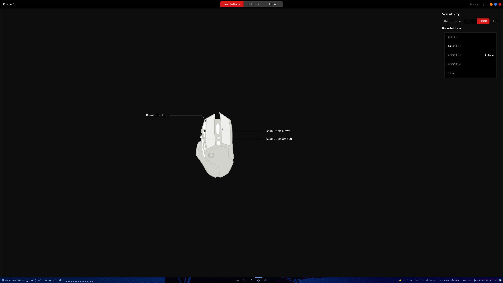
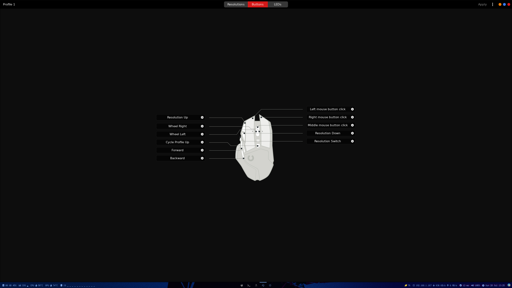
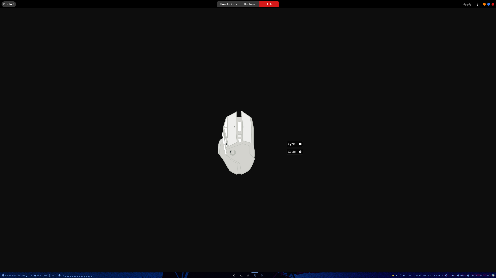

How to configure and use Logitech G502 on Arch Linux

## How to configure and use Logitech G502 on Arch Linux

After switching to Arch Linux from Windows and having a Logitech G502 I needed to configure both dpi and configurable buttons, even turn off the leds at night.

Thanks to a friend who taught me [piper](https://github.com/libratbag/piper) program made in Python which allows us to configure our G502 and more models [here the list ](https://github.com/libratbag/libratbag/tree/master/data/devices)

In my case using Arch Linux I already had the package in the [AUR](https://aur.archlinux.org/), but in the github repository of piper we have explained how to install it [Wiki](https://github.com/libratbag/piper/wiki/Installation)

Once installed it is as easy as launching the program.

In this screen we can modify the dpi and sensitivity.

In this we can change the functions of the different buttons.

Finally here we can modify the leds.

To apply the changes we simply have to push the right corner "Apply".
