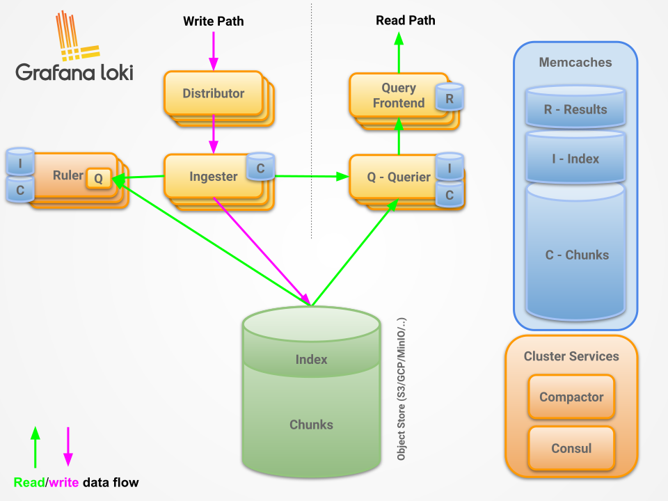

Loki is Grafana's log database. What sets it apart from Elasticsearch or OpenSearch is that it doesn't index the content of your logs, only the labels (Prometheus style). The text of each line goes compressed into chunks in an object store (S3, GCS, Azure, MinIO or local disk), so the index stays a small fraction of the log volume.

That has a price: if you search for something that isn't a label, Loki has to decompress and scan every chunk in the time range you asked for. Most of what you need to know to run Loki well comes from that, so this post covers how it's built inside, which deployment mode to pick, which labels to use (and which not to) and how to set up retention. Everything refers to Loki 3.x.

## How it works inside



There are two paths: write and read.

On the write path, the agent that collects the logs (today Grafana Alloy, more on that below) sends them to the **distributor**. The distributor validates each stream (valid labels, size and rate limits) and spreads it across several **ingesters** using a hash ring. Ingesters build up each stream's lines into in-memory chunks and, when a chunk is full or old enough, compress it and upload it to the object store. Each stream is written to several ingesters (the `replication_factor`, usually 3), so losing one doesn't lose what it had in memory.

On the read path, the LogQL query reaches the **query frontend** (optional), which splits it into smaller time ranges and queues them. **Queriers** pick those pieces up and run them in parallel, asking the ingesters for recent data (not uploaded yet) and the object store for the rest. They deduplicate lines with the same timestamp, labels and content, which show up repeated because of replication.

Three more pieces are worth knowing:

- **Compactor:** compacts the index files and applies retention and deletes. If you don't enable it, Loki never deletes anything.
- **Ruler:** evaluates LogQL rules on a schedule, for alerts on logs or to turn logs into metrics (recording rules).
- **Index gateway:** serves the index to queriers so each one doesn't have to download it. It only makes sense in large deployments.

## Which deployment mode to pick

Loki is a single binary, and the `-target` flag decides which components each process runs. That gives three ways to deploy it:

| Mode | What it is | Volume |
|---|---|---|
| Monolithic | Everything in one process (`-target=all`) | Up to about 20 GB per day according to the docs, and it can run in HA with several replicas |
| Simple scalable (SSD) | Three groups: read, write and backend | Up to close to 1 TB per day, but it's **deprecated** |
| Microservices | Each component on its own (`deploymentMode: Distributed` in the chart) | What Grafana recommends for production at scale |

The simple scalable part matters if you're building something new: the Loki 3.x docs say it will be removed in Loki 4.0 and won't start in that mode. The replacement they suggest for most cases is HA monolithic, which is monolithic with several replicas, a shared object store and `memberlist` to share the ring.

This is what I'd do: for a homelab or a small cluster, monolithic with one replica and local disk or MinIO, which is what the Helm chart installs by default (`deploymentMode: Monolithic`). If it has to survive losing a node, monolithic with 3 replicas and an object store. I'd only consider microservices past tens of GB per day, because that's around 8 separate deployments to scale and watch.

## Labels: the decision that matters most

Every unique combination of label values is a separate **stream**, with its own index entries and its own chunks. If a label has many possible values (high cardinality), the number of streams multiplies, chunks end up small and half empty, the index grows and both ingestion and queries get slower. It's the most common cause of a slow or expensive Loki.

The rule of thumb is to label only what has few values and what you'll always filter on:

```text
Good:  cluster, namespace, app, job, env, level
Bad:   pod, container_id, request_id, trace_id, user_id, IP, HTTP status code
```

`pod` is the one that sneaks in most, because many configs add it by default. Every rollout creates new pod names, and with them new streams. To find a specific pod, a text filter is enough:

```logql
{namespace="default", app="immich"} |= "immich-server-abc123"
```

If you need a high-cardinality field at hand (a `trace_id`, for example), Loki 3 has **structured metadata**: key-value pairs attached to each line that don't create streams. With Alloy:

```alloy
loki.process "default" {
  stage.json {
    expressions = { "trace_id" = "" }
  }

  stage.structured_metadata {
    values = { "trace_id" = "" }
  }

  forward_to = [loki.write.local.receiver]
}
```

Then you filter on it in the query like any other field: `{app="api"} | trace_id="abc123"`.

## Shipping logs: from Promtail to Alloy

If you run Promtail, it's time to migrate. Grafana moved its code into Alloy, deprecated it in Loki 3.x and it reached end of life on March 2, 2026, so there are no more updates. Alloy has a command that converts a Promtail config to its own format (`alloy convert --source-format=promtail`), so the migration is usually quick.

The good part of Alloy is that you can filter before sending anything, and that's what cuts volume the most. In my home cluster (mew) I was sending the logs of every pod to Grafana Cloud and measured about 2.45 GB per day, against a 50 GB monthly limit. At that rate I'd burn through it in under 3 weeks. The first thing I did was discard the lines that add nothing in Alloy (health checks, requests that end in 2xx, debug logs) and keep only a sample of the noisiest apps:

```alloy
loki.process "pod_logs" {
  forward_to = [loki.write.grafana_cloud.receiver]

  // Health checks and metrics endpoints
  stage.match {
    selector = "{job=~\".+\"} |~ \"GET /(health|healthz|ready|readyz|livez|metrics|ping)\""
    action   = "drop"
  }

  // ArgoCD: keep only 20% of the lines
  stage.match {
    selector = "{app=~\".*argocd.*\"}"

    stage.sampling {
      rate = 0.2
    }
  }
}
```

<!-- TODO Cristian: how much the daily volume dropped after the filters (the plan estimated ~0.35-0.50 GB/day, but I don't have the measured number). Also whether you ended up dropping `pod` from the labels (it's still set in mew/offline/alloy). -->

To decide what to filter first, this query shows which apps produced the most lines in the last 24 hours:

```logql
topk(10, sum by (app) (count_over_time({namespace=~".+"}[24h])))
```

## Retention: the compactor

By default Loki deletes nothing. To make it delete, you enable retention in the compactor and set how long to keep data in `limits_config`. With the current schema (TSDB and `v13`, which structured metadata needs) it looks like this:

```yaml
schema_config:
  configs:
    - from: "2024-04-01"
      store: tsdb
      object_store: s3
      schema: v13
      index:
        prefix: loki_index_
        period: 24h

limits_config:
  retention_period: 672h # 28 days

compactor:
  working_directory: /loki/retention
  retention_enabled: true
  delete_request_store: s3
```

Two things to know: the index period has to be 24h for retention to work, and the compactor doesn't delete right away. It marks the chunks and removes them after `retention_delete_delay` (2 hours by default). If your object store has its own lifecycle rules (S3 lifecycle policies, for example), make them longer than Loki's retention, or you'll delete chunks the index still thinks exist.

## A few LogQL queries to start with

LogQL looks like PromQL: first you select streams by label, then you filter or parse the content.

```logql
# Errors of one app, searching the text
{namespace="default", app="immich"} |= "error"

# Parse JSON and filter on a field
{app="api"} | json | status >= 500

# Error lines per minute per app, as a metric
sum by (app) (count_over_time({namespace="default"} |= "error" [1m]))
```

The last one turns logs into a time series you can put next to your Prometheus metrics in the same panel.

<!-- TODO Cristian: mew no longer runs Loki; logs go through Vector to VictoriaLogs (mew/cluster/vector and mew/cluster/vlogs). If you want, add a paragraph on why you switched. -->
