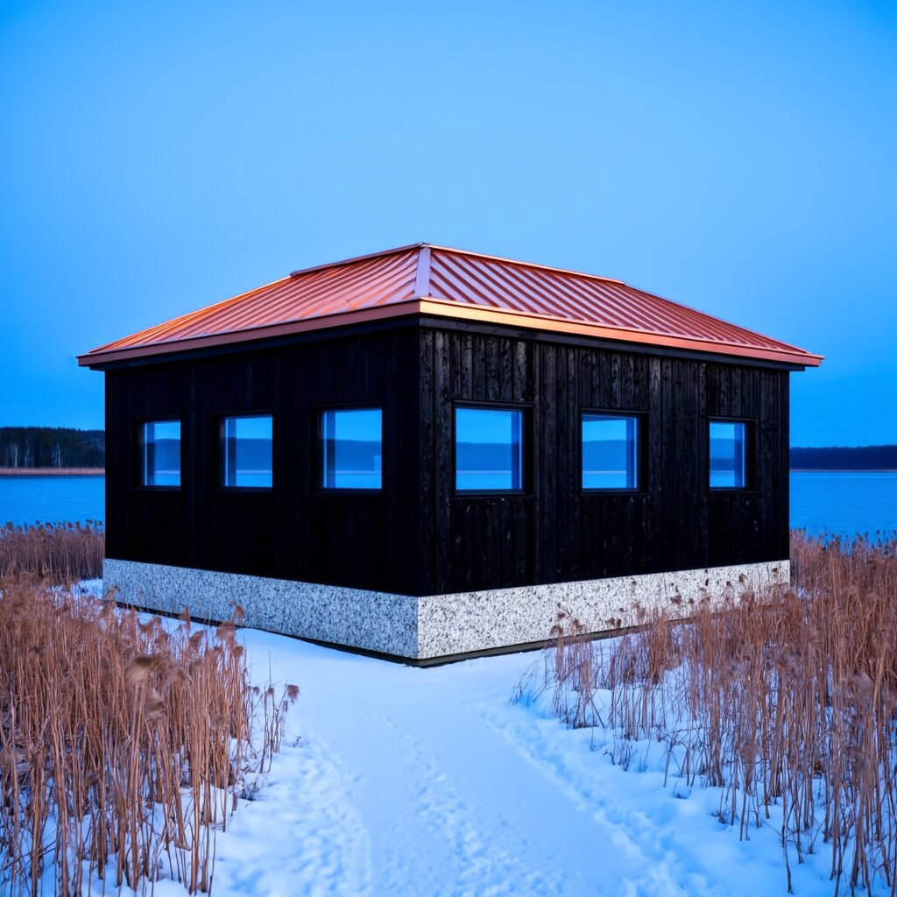
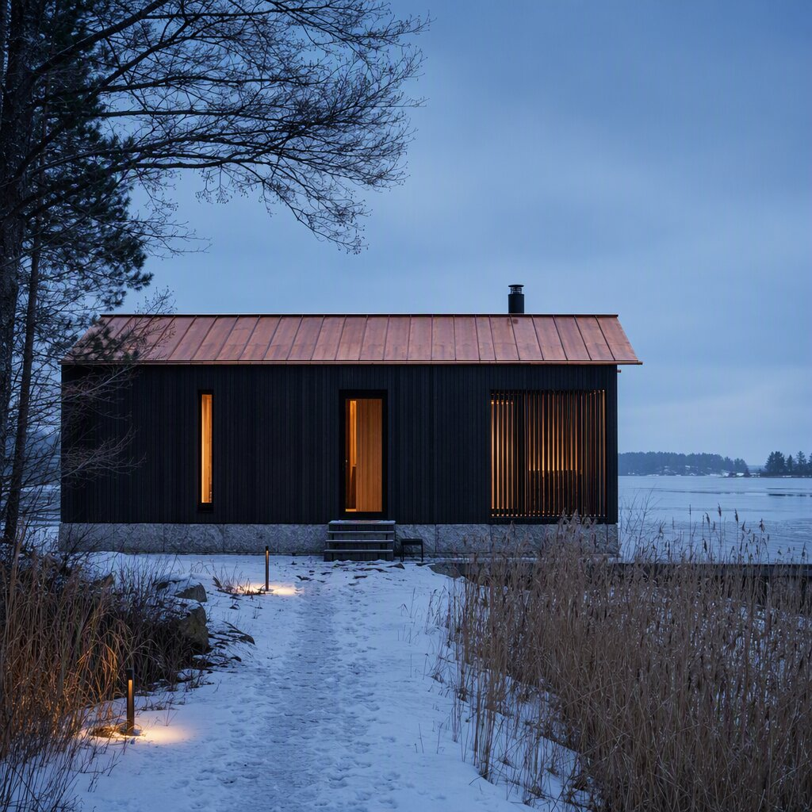
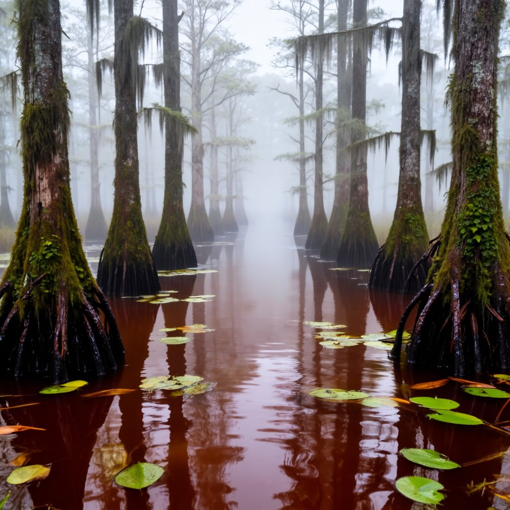
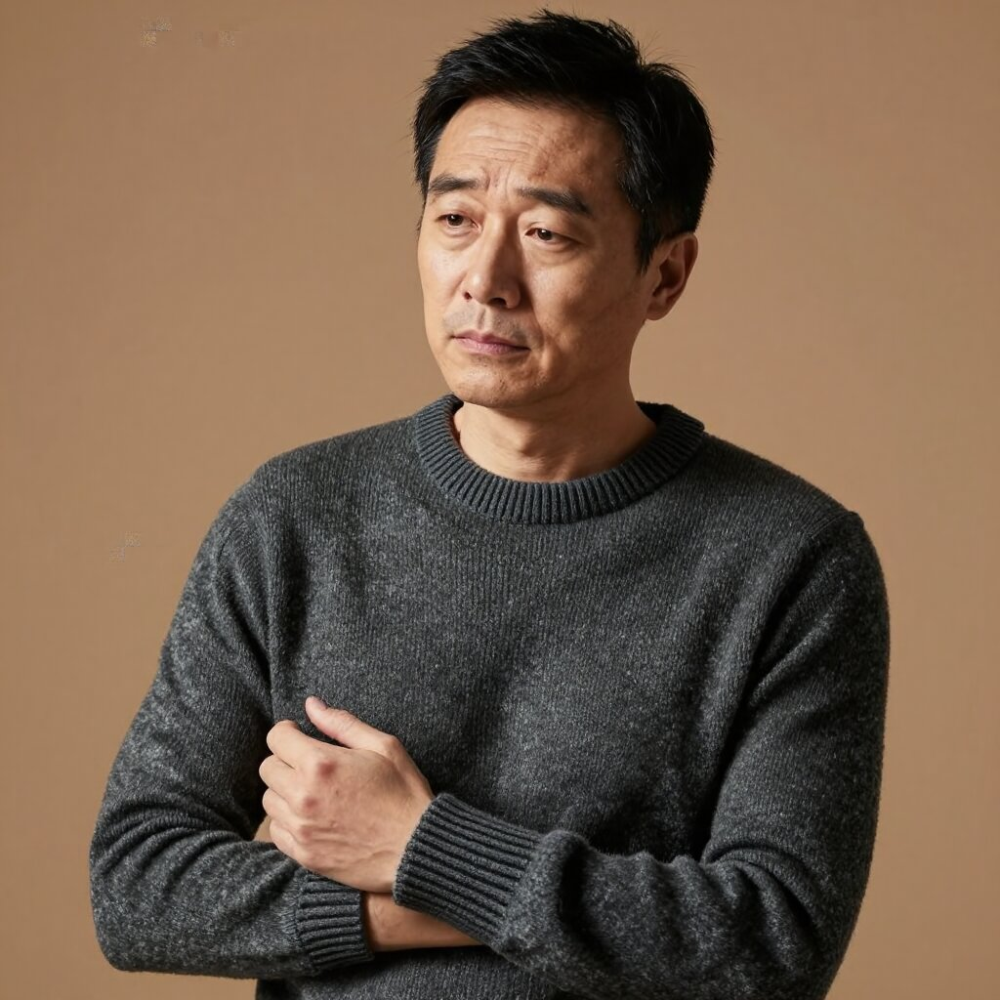
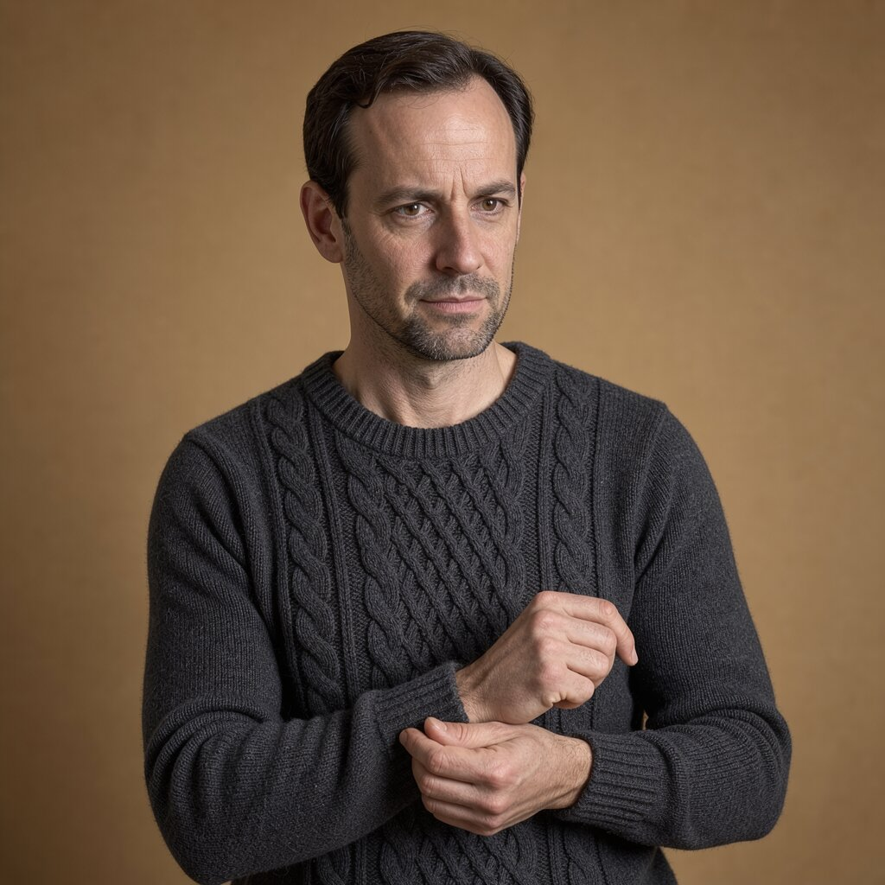
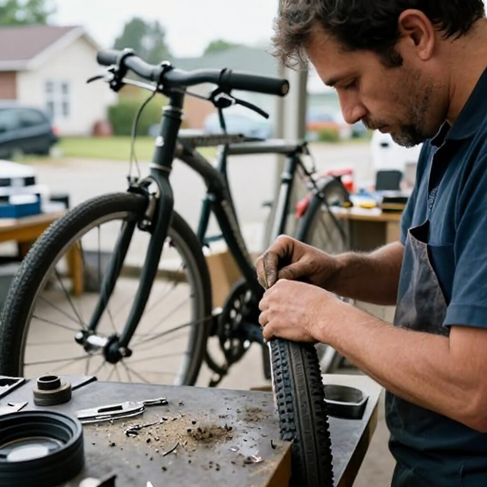
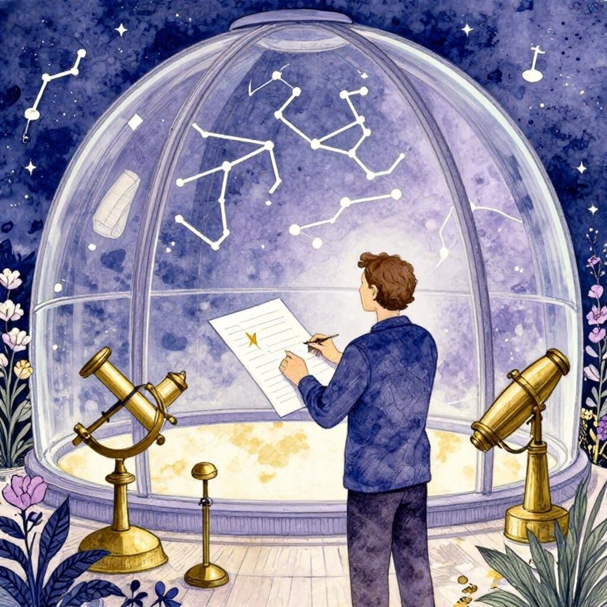
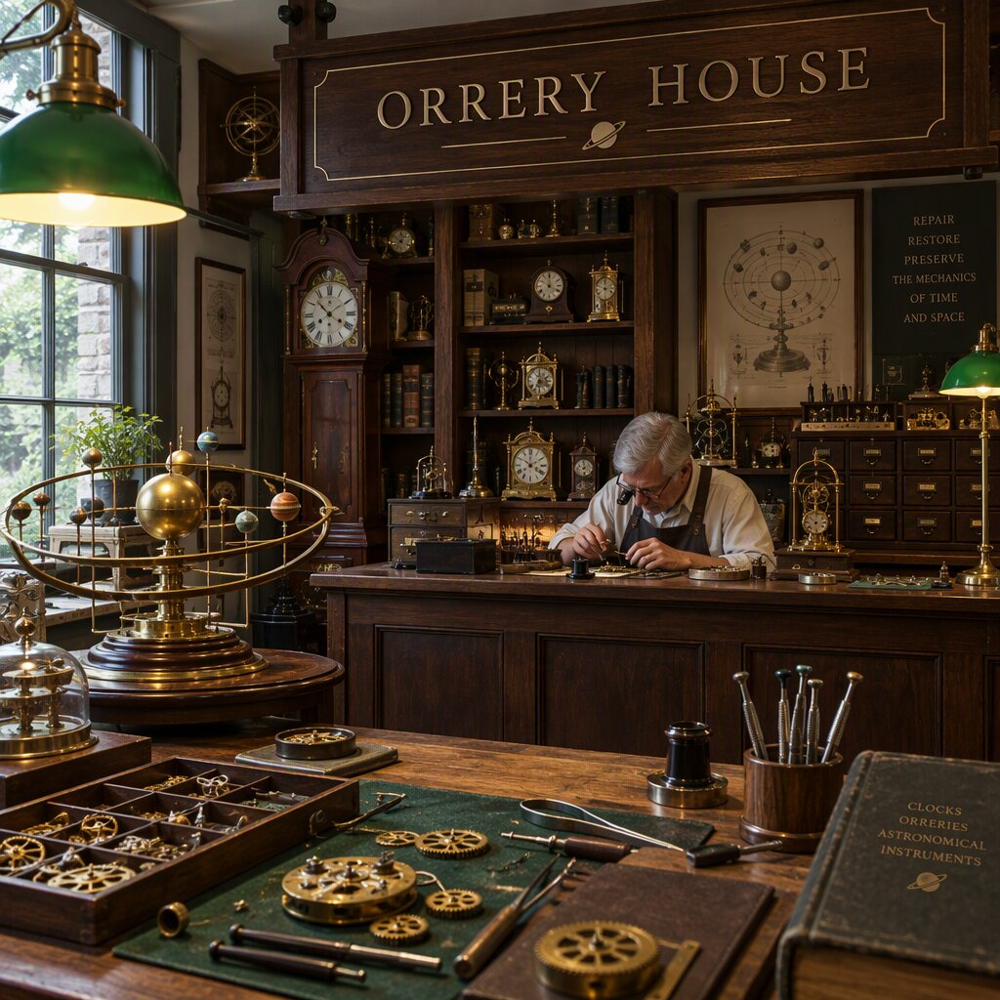

This week a new open image model came out of Spain 🇪🇸: **Iris-3B**, with just 3B parameters. I set it up on a GPU and put it against GPT Image, FLUX and friends with the same prompts.

One image per prompt, no fuss. Here are the results, since the prompts and the details don't fit in the [Twitter thread](https://x.com/crstiax) (in Spanish).

Before anyone jumps at me: I know this isn't a fair comparison. I'm not claiming a 3B model beats GPT Image. What I wanted to see is how far such a small model is from the best ones and what it can be useful for.

## What Iris-3B is

It comes from [speridlabs](https://speridlabs.com/research/iris) and it's Apache 2.0. It has 3B parameters, plus a frozen 4B text encoder (Qwen3-VL-4B-Instruct).

On their site they compare it with much bigger models, and it ties with them on one of the benchmarks:

| Benchmark (1024²) | Iris-3B | FLUX.1-dev 12B | Z-Image 6B | Qwen-Image 20B |
|---|---|---|---|---|
| OneIG | **0.540** | 0.434 | 0.546 | 0.539 |
| DPG | 86.5 | 83.8 | 88.1 | 88.3 |
| GenEval | 0.80 | 0.66 | 0.84 | 0.87 |

Keep in mind these numbers are their own. On DPG and GenEval it trails Z-Image and Qwen-Image, but beats FLUX.1-dev, which has 12B.

They also say where it struggles: long text inside the image, positions and counting objects.

## What "no VAE" means

What caught my eye the most is that it generates the image directly in pixels, with no VAE.

Almost every image model (Stable Diffusion, FLUX…) doesn't generate the image as such. A VAE (*Variational Autoencoder*) compresses it into something much smaller, the latent space. The model works on that, and at the end the same VAE turns it back into pixels. In FLUX, for example, a 1024×1024 image is handled as a 128×128 grid.

Like everything, this has its upsides and downsides. Compressing saves a huge amount of compute, but you lose information, and it shows mostly in textures and fine detail.

Iris skips that compression step and generates the pixels directly. It's more expensive to compute, but nothing in between eats away detail.

## How I tested it

I took the prompts from [BudgetPixel Arena](https://budgetpixel.com/arena/prompts). There, around 20 models render the same prompt and people vote without knowing which is which. Once voting closes, you can see which model made each image and by how much it won.

With Iris I did this:

- The prompt text as is, untouched.
- 1024×1024, seed 42, 100 steps and CFG 3.
- A single run per prompt. Whatever came out, goes.

In each comparison the Iris image comes first, with the arena winner next to it. The arena images are by BudgetPixel AI, licensed CC BY 4.0.

## Architecture: the sauna

> Exterior of a Scandinavian modernist lakeside sauna pavilion, blackened timber cladding, pale granite plinth, copper roof, winter blue-hour light glowing through narrow windows, viewed from a snowy reed-lined path, straight structural geometry and plausible construction.

 

One of my favourites. Charred timber, granite, copper roof, everything in place and with clean geometry.

That said, the prompt asked for warm light coming through the windows and there's no trace of it, and it looks a bit like a render. In the arena, GPT Image 2 won with 80% of the votes ([see all 20 versions](https://budgetpixel.com/arena/prompts/exterior-scandinavian-modernist-lakeside-sauna-451a)).

## Landscape: the swamp

> A cypress swamp at foggy sunrise after overnight drizzle, dark tea-colored water threading between moss-draped trunks; slick root knees and floating leaves lead toward pale trees disappearing into layered mist.

 

The fog, the roots and the floating leaves look great. But the water was supposed to be tea-coloured and it came out almost red.

In the arena, Muse Image 1.0 and Qwen Image 3.0 won with 68% ([see all 20 versions](https://budgetpixel.com/arena/prompts/cypress-swamp-foggy-sunrise-after-overnight-1e34)).

## Photography: portrait and documentary

> Editorial portrait of an adult man in his early 40s wearing a charcoal wool fisherman's sweater, one hand loosely holding its ribbed cuff. His thoughtful, slightly tired expression rests against a muted ochre studio backdrop, shaped by gentle directional window light.

 

> Candid documentary photograph of an adult bicycle mechanic repairing a flat tire outside a neighborhood workshop, soft overcast daylight, 35mm lens with moderate depth of field, greasy fingerprints, dust, and tiny metal shavings visible on the workbench.

 

Photography is where it surprised me the most. Both pass for real photos, and the mechanic one has the grease and the metal shavings on the bench.

Where it slips is the details. The sweater was supposed to be a cable-knit fisherman's sweater and it came out as a plain crew neck, plus a few small artefacts in the top left. FLUX 3 Image won with 91% ([portrait](https://budgetpixel.com/arena/prompts/editorial-portrait-adult-man-his-early-d578)) and Kling v3 with 88% ([mechanic](https://budgetpixel.com/arena/prompts/candid-documentary-photograph-adult-bicycle-f444)).

## Illustration: watercolour and mechanical heart

> Ink-and-watercolour illustration of an adult astronomer mapping constellations from a glass-domed observatory, surrounded by brass instruments and flowering night plants. Indigo, lavender, and pale gold palette, delicate linework, serene atmospheric detail.

 

> A beautifully intricate mechanical heart floating alone in deep darkness, designed like an exquisite piece of horological sculpture. Its polished brass, copper, and dark steel chambers are partially open, revealing layers of tiny interlocking gears, delicate springs, pistons, and precision mechanisms within. Sections of crystal-clear glass expose deeper workings, while slender tubes carry a faintly glowing fluid through the heart like an artificial bloodstream. Tiny gears turn and pistons move, suggesting that the heart is genuinely functioning. Fine mechanical filaments curl outward like veins and arteries, catching subtle highlights from the warm inner glow. Elegant steampunk aesthetic, dramatic cinematic lighting, rich metallic textures, intricate reflections, mysterious atmosphere.

 

The watercolour nails the style, the palette, the brass and the flowers. The heart is very good, glowing fluid tube and all, though less intricate than the prompt asks for.

GPT Image 2.5 Sunburst won both, the heart with 100% of the votes, so the bar was high ([watercolour](https://budgetpixel.com/arena/prompts/ink-watercolour-illustration-adult-astronomer-0f76), [heart](https://budgetpixel.com/arena/prompts/beautifully-intricate-mechanical-heart-floating-fb69)).

## Its weak spots: counting and text

Since they say it struggles with counting objects and with long text, I went straight for that.

> Exactly three green apples and two yellow pears on a white plate, the plate on a blue tablecloth, nothing else on the table.

 

Three apples and two pears, first try. In the arena, ImagineArt 1.5 Pro won with 100% ([see all 20 versions](https://budgetpixel.com/arena/prompts/adh-count)).

> Inside a quiet clockmaker's workshop, brass gears and tiny tools gleam beneath green-shaded lamps; "ORRERY HOUSE" is engraved in crisp serif letters on a dark walnut sign above the repair counter.

 

It got the text right too. Not a single wrong letter, green lamps included, although the sign looks painted rather than engraved.

Mind you, it's two words. They say it struggles with long sentences and I haven't tried that. GPT Image 2.5 Flare won with 88% ([see all 20 versions](https://budgetpixel.com/arena/prompts/inside-quiet-clockmaker-workshop-brass-gears-682d)).

And before anyone gets carried away: in an earlier run, at 1344×768 and with another seed, the fruit came out as 2 and 2. With one image per prompt there's a lot of luck involved, so if you try it, generate several.

## How long it takes

I ran it on an NVIDIA RTX PRO 6000 Blackwell Max-Q (96 GB) I had set up for a talk. PyTorch 2.11 with CUDA 13.0, the official code and its Gradio demo as they come: FP32 weights, BF16 generation, no quantisation and no tuning.

| Test (1024×1024) | Time per image | Peak VRAM |
|---|---|---|
| 100 steps (default) | **32.5 s** | 25.9 GiB |
| 50 steps | 16.6 s | 25.9 GiB |
| 25 steps | 8.4 s | 25.9 GiB |
| Batch of 8, 100 steps | 38.1 s | 35.5 GiB |
| 512×512, 100 steps | 10.0 s | 25.0 GiB |

Batching doesn't help. A single image already keeps the GPU at 100% (about 325 W), so it's a compute-bound workload, the opposite of generating text with an LLM.

## Wrapping up

For an open 3B model, I'm pretty impressed. It doesn't beat the best ones, but it gets closer than I expected, and you can run it on a single GPU under Apache 2.0.

If you want to try it:

- Model: [huggingface.co/speridlabs/iris-3b](https://huggingface.co/speridlabs/iris-3b)
- Paper: [arXiv 2610.09450](https://arxiv.org/abs/2610.09450)
- Code: [github.com/speridlabs/iris-3b](https://github.com/speridlabs/iris-3b)
- Demo: [huggingface.co/spaces/speridlabs/iris-3b](https://huggingface.co/spaces/speridlabs/iris-3b)
- Arena prompts and images: [BudgetPixel Arena](https://budgetpixel.com/arena/prompts) (BudgetPixel AI, CC BY 4.0)
