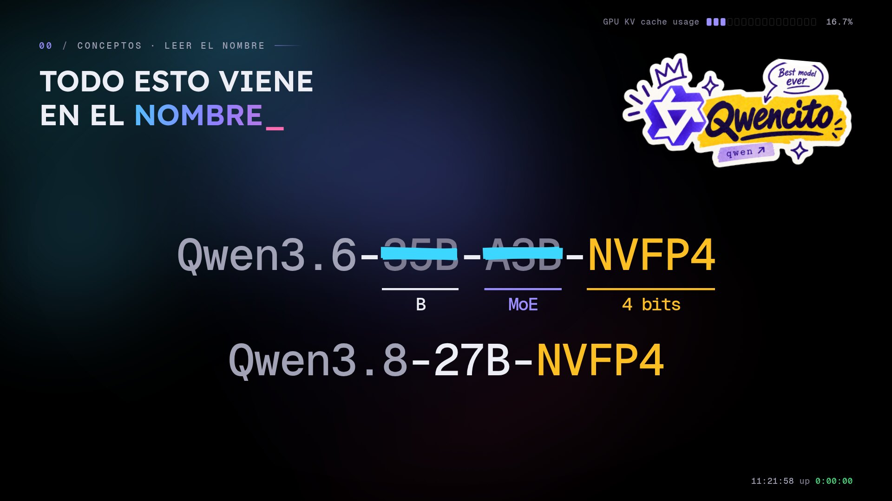
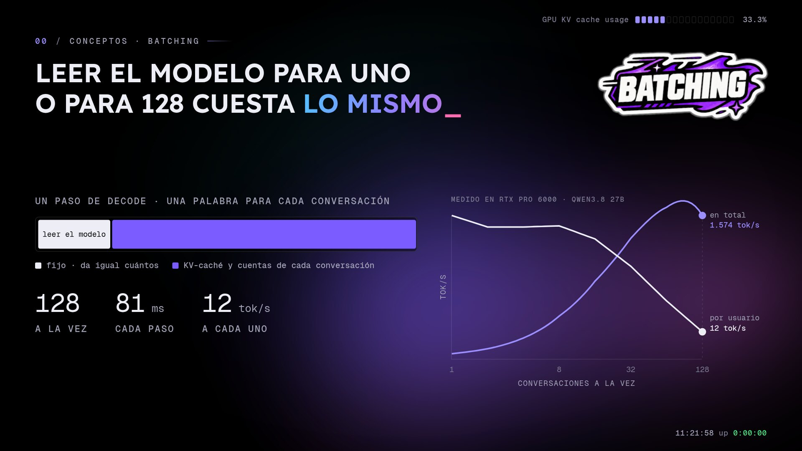
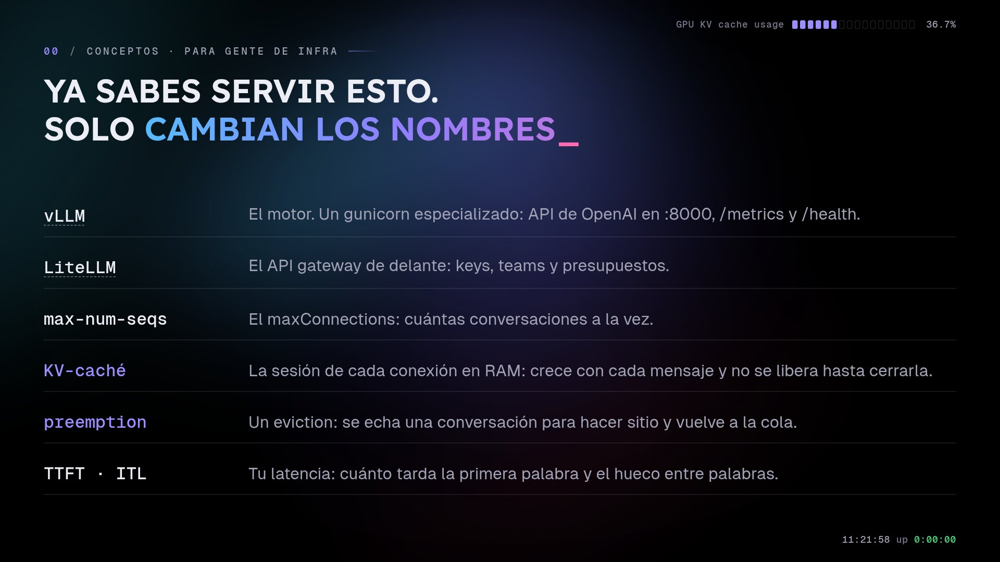
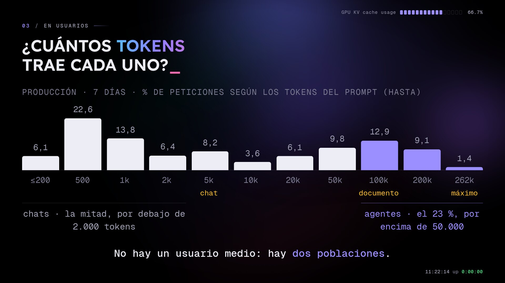
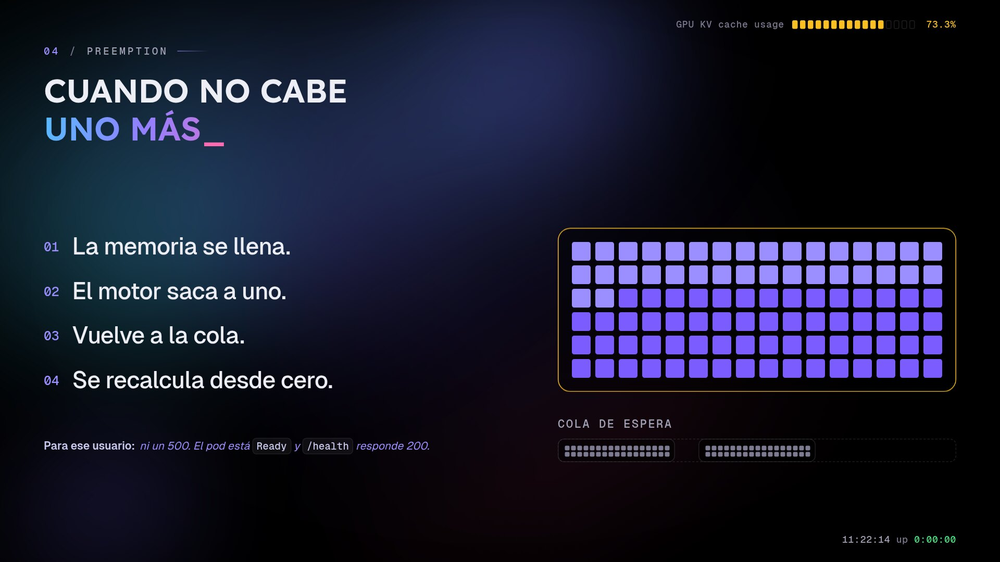
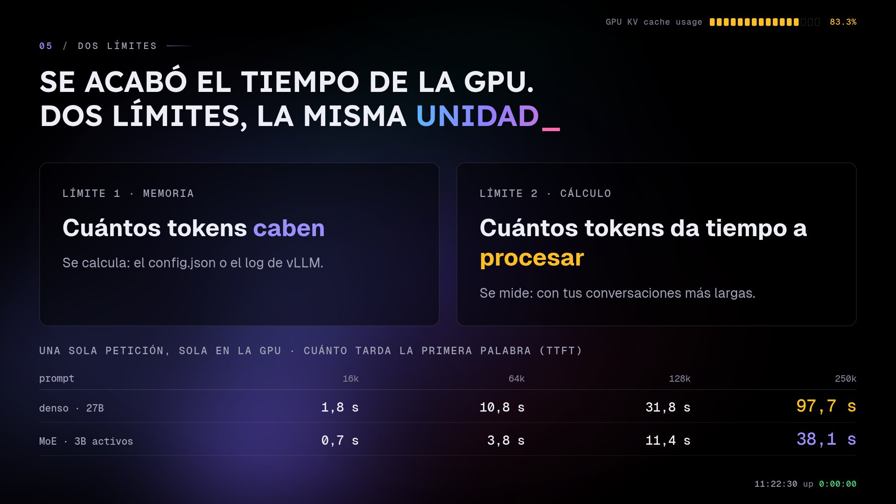
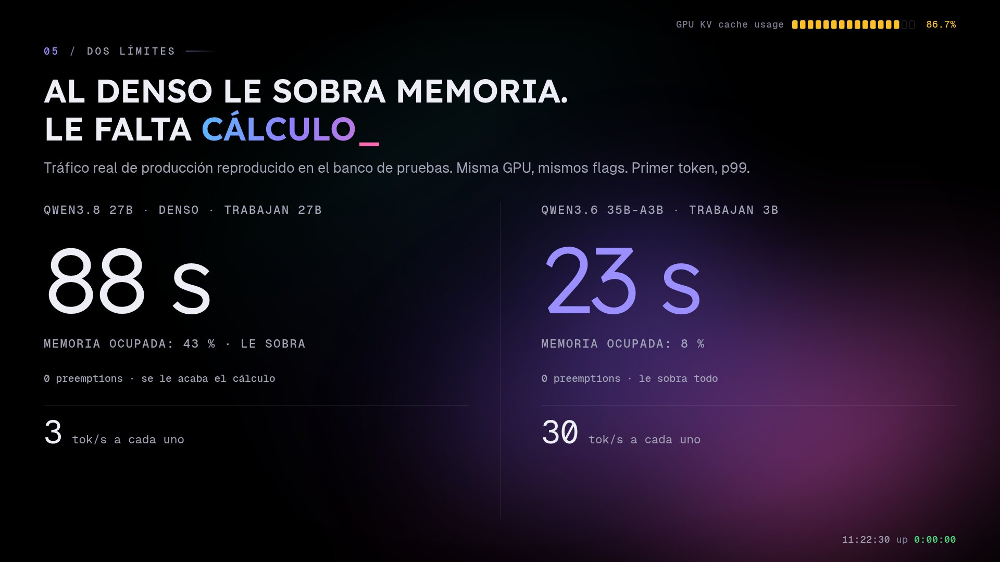
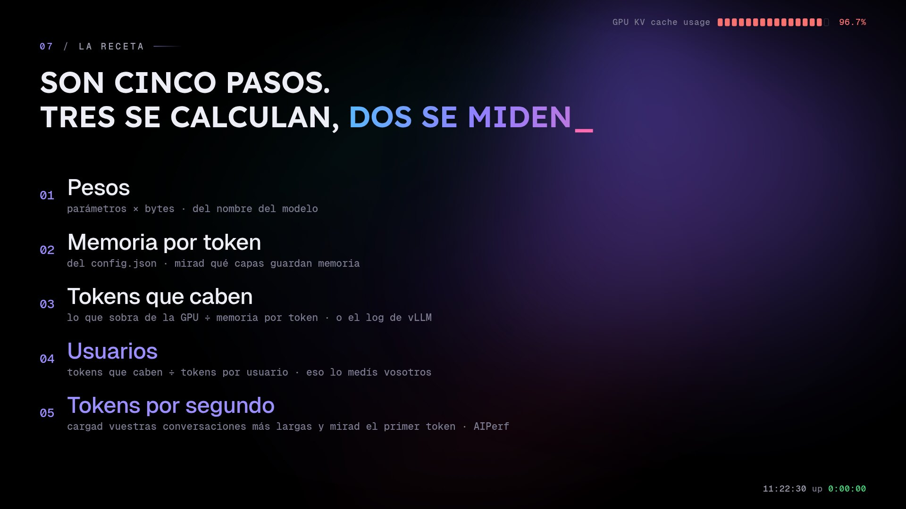

On Saturday I gave a talk at **AWS Community Day Spain 2026** in Santiago de Compostela: *Sizing by tokens, not by gigabytes*. It's about a question that sounds like a beginner's question and isn't: how many users can one GPU serve with a language model.

The usual answer is to compare the model's gigabytes with the card's. That tells you whether the model starts, not how many people it can serve. This post is the written version, with the talk's slides (they're in Spanish) and a bit more detail than fits in thirty minutes. The full deck is at [talks.crstian.me](https://talks.crstian.me/aws-community-day/).

Everything here comes from [Helmcode](https://helmcode.com)'s machines, either production or a test bench with the same GPU and the same configuration, and I say which each time. The model is **Qwen3.6-35B-A3B in NVFP4, served with vLLM on an RTX PRO 6000 Blackwell with 96 GB**. For contrast I use a model from the same family, Qwen3.8-27B, which is dense.

## Quick summary

The recipe has five steps. You calculate the first three and measure the last two:

1. **Weights**: parameters × bytes per parameter. It comes from the model name.
2. **Memory per token**: from `config.json`, checking how many layers keep memory.
3. **Tokens that fit**: what's left on the GPU divided by memory per token. Or the line in the vLLM log.
4. **Users**: tokens that fit divided by tokens per user. That number isn't in any file; you measure it.
5. **Tokens per second**: load the GPU with your longest conversations and watch the first token.

There are two limits, and both are measured in tokens: how many fit (memory) and how many the GPU has time to process (compute).

## Five concepts first

### Everything is counted in tokens


A model doesn't see words, it sees tokens: chunks of text. With the Qwen3.6 tokenizer, "¿Cuántos usuarios aguanta mi GPU?" is five words and ten tokens. The same question in English is seven words and eight tokens. Tokenizers are trained mostly on English text, so other languages pay more tokens for the same thing.

What you send is the prompt and what you get back is the response, and both cost tokens. The context is every token in a conversation: the system prompt, the history and what the model has generated so far. Each model has a maximum in its `config.json`. Mine takes 262,144.

### How to read a model's name



A model is a pile of numbers, the weights, which load fully into the GPU at startup and don't change. The name carries three facts you need for sizing:

- **35B**: about 35 billion parameters. That's what it takes up.
- **A3B**: 3 billion active per token. It's an MoE (*mixture of experts*): each layer has 256 experts and a router picks 8 for every token. It takes up memory like a big model and computes almost like a small one, but all 35 billion must stay loaded, because you don't know which expert the next token will ask for.
- **NVFP4**: NVIDIA's 4-bit format, half a byte per parameter.

35 billion at half a byte is about 18 GB. In practice it's 20.4 GiB, because not everything is in 4 bits: attention is FP8, the embeddings and the vision encoder stay in 16 bits, and every block of 16 weights stores its scale.

The rival, **Qwen3.8-27B-NVFP4**, has no A: it's dense, and all 27 billion parameters work on every token.

### Prefill and decode


A request has two phases that behave very differently:

- **Prefill**: reading the whole prompt at once, in parallel. With a hundred thousand tokens that's a lot of compute and it takes a while. It shows up in **TTFT** (*time to first token*), which is queue time plus prefill.
- **Decode**: writing the response one token at a time. For every new token, the GPU reads the whole model from memory, so what limits it is memory bandwidth more than compute. It shows up in **ITL** (*inter-token latency*), the time between one token and the next.

### The KV cache

To generate each token, the model looks back at the whole conversation. Recomputing it every time would be very slow, so it stores two vectors for every token it has seen, K (*key*) and V (*value*). That store is the **KV cache**, and it's the most important concept in this post.

The weights load once and stay fixed. The KV cache grows with every token the user writes and every token the model answers. Each conversation takes its own space, and that memory isn't freed until the request finishes.

### Quantization: what you gain and what you lose

In 16 bits, my 35B model would take about 65 GiB. In NVFP4 it's 20.4.

The KV cache is quantized separately, and for sizing it's the decision that matters most. In 16 bits each token would take 20 KB; with `--kv-cache-dtype fp8` it takes 10 KB. The same memory holds 6 million tokens instead of 3. It's also faster, because decode has fewer bytes to read on every step. That said, quantizing the KV cache can cause real quality problems, especially in long conversations. Measure before you switch.


And how much do 4-bit weights lose? This is the table NVIDIA publishes on the [model card](https://huggingface.co/nvidia/Qwen3.6-35B-A3B-NVFP4): eight benchmarks, in BF16 and NVFP4. The biggest loss is 0.8 points, long context loses nothing, and two scores go up (measurement noise).

But NVIDIA measured it, with English benchmarks, and calibrated the quantization on CNN news articles, also in English. The benchmark number isn't yours. Test it on your own tasks and in your own language before you switch formats, because results can vary a lot.

### Batching: reading the model for one user costs the same as for 128



On each decode step the GPU reads the model once, no matter how many conversations there are, and produces one token for each. I measured it on the bench with the dense 27B, with 2,000-token prompts and 500-token responses:

| Conversations at once | Tokens/s per user | Tokens/s total |
|---|---|---|
| 1 | 64 | 64 |
| 8 | ~60 | ~470 |
| 128 | 12 | ~1,570 |

With eight at once the step barely grows: that's almost free work. With 128, the KV cache and the per-conversation math outweigh reading the model, the step goes from 16 to 81 ms, and each person gets 12 tokens per second.

The operator sets that maximum with `--max-num-seqs`. I have it at 128, and it's a product decision: more people, or faster for each one.

### If you come from infrastructure, you already know how to serve this



| Inference | What you already know |
|---|---|
| vLLM | a specialised gunicorn: OpenAI API on `:8000`, `/metrics` and `/health` |
| LiteLLM | the API gateway in front: keys, teams and budgets |
| `max-num-seqs` | `maxConnections`: how many conversations at once |
| KV cache | each connection's session in RAM, growing with every message |
| preemption | an eviction: a conversation is kicked out to make room and goes back to the queue |
| TTFT · ITL | your latency: the first word and the gap between words |

## What's inside a 96 GB GPU


The RTX PRO 6000 Blackwell has 95.6 GiB usable, and with `--gpu-memory-utilization 0.93` vLLM takes 93 % of it at startup, whether there's traffic or not:

| Part | GiB |
|---|---|
| The model | 20.4 |
| The engine (buffers and intermediate work) | 7.3 |
| **Conversations (KV cache)** | **61.2** |
| Headroom vLLM doesn't touch | 6.7 |

The number that matters is the 61 GiB for conversations, not the model's 20.

### The 95 % in nvidia-smi tells you nothing

```
93734MiB / 97887MiB      0%
```

This `nvidia-smi` comes from a production machine: memory at 95 % and utilisation at 0 %, with not a single request in flight. vLLM reserves all its memory at startup, so that 95 % is there from the first second. It will never tell you anything about load.

## How much one token takes: config.json


You don't have to guess: it's in the `config.json` that ships with the model. In this Qwen the fields sit under `text_config` because it's multimodal:

```bash
jq '.text_config | {num_hidden_layers, num_key_value_heads, head_dim}' config.json
```

```json
{ "num_hidden_layers": 40, "num_key_value_heads": 2, "head_dim": 256 }
```

The maths, one factor at a time:

- Each layer stores `num_key_value_heads × head_dim` values per token: 2 × 256 = 512. With the cache in FP8, each value is one byte: **512 bytes**.
- It's stored twice, once for K and once for V: **1,024 bytes**.
- And here's the trick: out of 40 layers, only 10 keep memory. The `layer_types` field marks 10 as `full_attention` and 30 as `linear_attention`, which summarise the past in a fixed-size state that doesn't grow. So you multiply by 10, not 40: **10,240 bytes, about 10 KB per token**.

If you divide the cache memory vLLM reports by the number of tokens it says fit, you get 10.8 KB. The difference is the state of the linear layers.

### MoE versus dense: the smaller model takes three times more


Qwen3.8 27B is smaller on disk, but it has 64 layers, 16 of them keep memory, and each has twice the KV heads. It comes to **34 KB per token**, three times the 35B model.


Across the whole GPU, with almost the same weight size (20.4 versus 19.8 GiB), the MoE fits **6,082,932 tokens** of conversation and the dense model **1,905,817**. The model fit on both; what changes is how many people it can serve. So when a new model comes out, the first thing to do is open its `config.json` and check `num_key_value_heads` and `layer_types`.

### vLLM does the maths for you

You don't need to work it out by hand. vLLM writes it to the log at startup, and these three lines are from my production:

```
INFO [gpu_worker.py:538]      Available KV cache memory: 61.24 GiB
INFO [kv_cache_utils.py:2146] GPU KV cache size: 6,082,932 tokens
INFO [kv_cache_utils.py:2147] Maximum concurrency for 262,144 tokens per request: 23.20x
```

Memory for conversations, tokens that fit, and how many max-context requests fit at once. They're in your logs and almost nobody reads them.

## How many users fit?

It's a division: 6,082,932 tokens divided by the tokens each user brings.

| Each user brings | By memory | Fit at once |
|---|---|---|
| a chat, 2,500 tokens | 2,433 | **128**, the `max-num-seqs` cap |
| a document, 100,000 tokens | 60.8 | **60** |
| the full context, 262,144 tokens | 23.2 | **23**, the `23.20x` in the log |

With chats, memory isn't the limit; the cap I set is. Up to about 47,500 tokens per user (6,082,932 ÷ 128) you get 128. Beyond that, memory decides. So the answer ranges from 128 to 23, and it depends on a number that isn't in any config file.

This is concurrency: how many conversations fit in the KV cache together, not how many daily users the product has.

### There's no average user



This is my production over one week: what share of requests brings up to how many prompt tokens. It has two humps. On the left, chats: 48.9 % of requests are under 2,000 tokens. On the right, agents: 23.4 % go over 50,000, because they resend the whole history on every turn. (Overall, 81 % of input tokens are reused through *prefix caching*, so agents don't recompute everything each turn.)

All three rows of the table above exist in my traffic at the same time. If you size with the average, you get both populations wrong.

## When one more doesn't fit: preemption



When the KV cache is full, vLLM doesn't return an error. It does this:

1. It picks a running conversation and takes its memory to give to the others.
2. That request goes back to the queue, at the front.
3. When there's room, it comes back in. But its memory is gone, so its whole conversation is recomputed from scratch.

That's a **preemption**. For that user the request doesn't fail: no 500, the pod is `Ready` and `/health` returns 200. It just stalls silently while it's recomputed, and then carries on.

**It doesn't fail, it slows down.** That's worse than an error, because no alert fires.

### What it looks like on the test bench


Qwen3.8 27B on the bench, with the same GPU and configuration as production. The line is how long a short question takes depending on the minute it arrives, and below it is the KV memory in use.

- At first there are only short questions: **7 seconds**.
- From minute 3, 22 conversations of 100,000 tokens arrive. The short question goes to **5 minutes**, with memory half full and **zero preemptions**.
- From minute 7 memory fills up and preemptions start (the red marks). Almost **10 minutes**, with a p99 of **577 seconds**.
- When the long ones finish, the queue drains and it's back to 7 seconds.

928 requests and zero errors. Nothing fails; it's just slow.

Look at the second stretch, though: the short question already took five minutes with memory half full and no preemptions. Something ran out before memory did.

## Two limits: memory and compute



What ran out was GPU time. Every long conversation has to be read in full (the prefill) before the model answers, and meanwhile the short question waits in the queue. There are two limits, and both are measured in tokens:

1. **Memory**: how many tokens fit. You calculate it from `config.json` or the vLLM log.
2. **Compute**: how many tokens there's time to process. You can't calculate it; you measure it with your longest conversations.

To show how much compute matters, this is the time to first token for a single request, alone on the GPU, with no queue and nobody else:

| Prompt | Dense 27B | MoE, 3B active |
|---|---|---|
| 16k tokens | 1.8 s | 0.7 s |
| 64k tokens | 10.8 s | 3.8 s |
| 128k tokens | 31.8 s | 11.4 s |
| 250k tokens | **97.7 s** | **38.1 s** |

Almost a hundred seconds just to read the prompt.

### The dense model has memory to spare and not enough compute



I replayed real production traffic on the bench with both models, same GPU and same flags. First token, p99:

- **Dense**: **88 seconds**, with memory at 43 % and zero preemptions. It runs out of compute long before memory.
- **MoE**: **23 seconds**, with memory at 8 %.

Agents make it even clearer. With 24 real coding-agent sessions at once, the dense model gives each user **3 tokens per second**, which is useless. The MoE gives **30**. The MoE wins twice: less memory per token (10 KB versus 34) and less compute per token (3 billion active parameters versus 27 billion).

## What to watch in production: one metric per limit

For **memory**, `vllm:num_preemptions_total`: how many times the engine has evicted someone. In my production it's been zero for thirty days, and peak memory the week I measured was 23 %. At 10 KB per token I have plenty to spare.

For **compute**, `vllm:inter_token_latency_seconds`: the gap between one word and the next. When things are fine it's about 6 ms. On the bench, with twelve agents at once, one of them got 18 seconds without a single word, and with no preemptions at all.

Watch the gap, not the total request latency. A request can take minutes and be perfectly fine if you asked for a lot of text. What gives the problem away is text that stops coming. When you see a spike, cross-check it with the vLLM log, whose stats line gains a `Preemptions:` field as soon as the counter stops being zero. I wrote about jumping from a metric to its logs in [correlating metrics and logs with Grafana and Loki](/en/post/2024-05-02-correlacion-metricas/).

And the alert, which takes five minutes to set up:

```yaml
groups:
  - name: vllm
    rules:
      - alert: VLLMPreemptions
        expr: increase(vllm:num_preemptions_total[5m]) > 0
        labels:
          severity: warning
        annotations:
          summary: "vLLM is evicting conversations because the KV cache is full"
```

## There's no formula: raise the load until it breaks


It might feel like a bit of a bait-and-switch: all that maths and now there's no formula. Memory you can calculate, and the maths above holds. What has no formula is compute, because it depends on your traffic: how long the prompts are and how many arrive at once. That's why the real number comes from a load test.

Take your traffic and raise the load until your target breaks. Mine is that the first word arrives in 15 seconds or less (that's my target, not a standard). With real production traffic on the bench, and the dense model:

| Requests/hour | First token in ≤ 15 s | Peak memory |
|---|---|---|
| 540 | 100 % | 10 % |
| 1,044 (my production average) | 86 % | 43 % |
| 1,800 | 39 % | 98 % |
| 3,600 | 0 % | 100 %, with preemptions |

My number, for this model on this GPU, is between 540 and 1,000 requests per hour. And it breaks with memory under half full: compute again.

## The five-step recipe



It isn't exact, but it gets you close:

1. **Weights**: parameters × bytes per parameter, from the model name.
2. **Memory per token**: from `config.json`, checking which layers keep memory.
3. **Tokens that fit**: what's left on the GPU divided by memory per token, or the `GPU KV cache size` line in the vLLM log.
4. **Users**: tokens that fit divided by tokens per user. Measure what each user actually brings, and don't settle for the average.
5. **Tokens per second**: load the GPU with your longest conversations (with NVIDIA's [AIPerf](https://github.com/ai-dynamo/aiperf), or your real traffic) and watch the first token. If it shoots up before memory fills, your limit is compute.

## FAQ

### How much VRAM do I need to serve an LLM?

Enough for the weights (parameters × bytes per parameter), plus the KV cache your users need, plus about 7 GB for the engine. On a 96 GB GPU with a 35B model in 4 bits, the weights are 20 GiB and the KV cache 61.

### How do I work out how many users a GPU can serve?

Divide the tokens vLLM reports in its startup log (`GPU KV cache size`) by the tokens per request, prompt plus response. Take the smaller of that result and `max-num-seqs`. That's the memory limit; the compute limit has to be measured with a load test.

### What is an LLM's KV cache?

The K and V vectors for every token already processed, which the model keeps so it doesn't recompute the whole conversation on every step. It grows with every token of every user and isn't freed until the request finishes.

### What is a preemption in vLLM?

When the KV cache is full, vLLM takes a running request out, frees its memory and sends it back to the queue. When it returns, it recomputes its whole conversation from scratch. The user doesn't see an error; they see a pause that can last minutes.

### Is an MoE or a dense model better for serving many users?

In my tests, the MoE: Qwen3.6-35B-A3B takes 10 KB per token against Qwen3.8-27B's 34 KB, and since only 3 billion parameters work on each token, it also needs far less compute. With real traffic it gave a p99 first token of 23 s against 88 s.

---

The slides and material from the talk are at [crstian.me/talks](https://crstian.me/talks). If you want to see this running with lots of people on it, drop by [NaN](https://nan.builders), the community that shares these GPUs. And if you've got a weird p99 this week, write to me.
