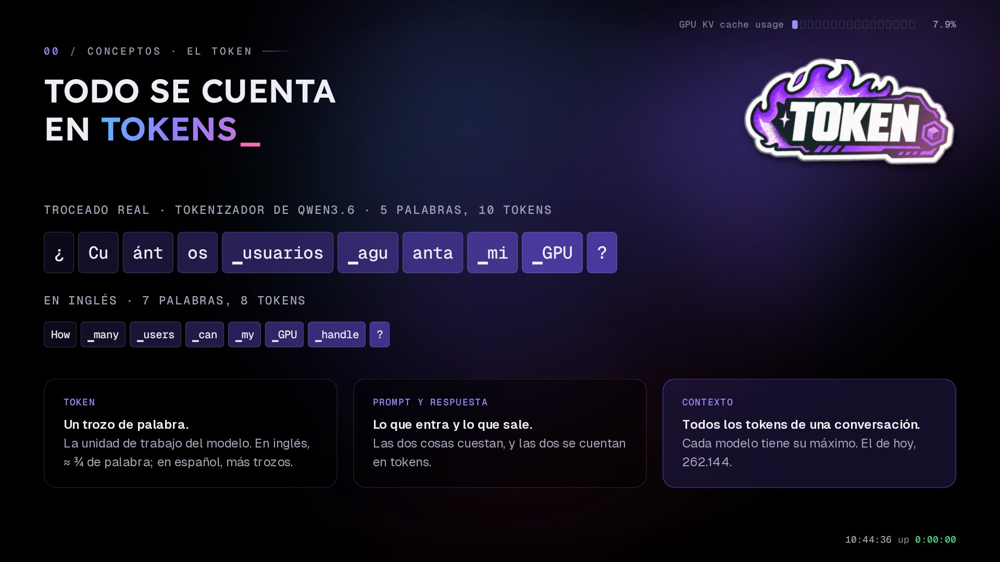
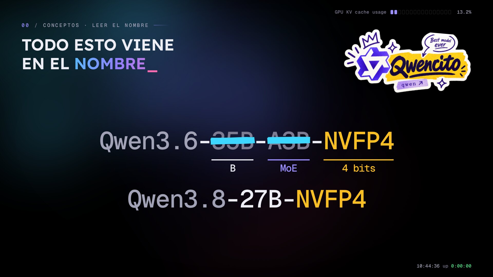
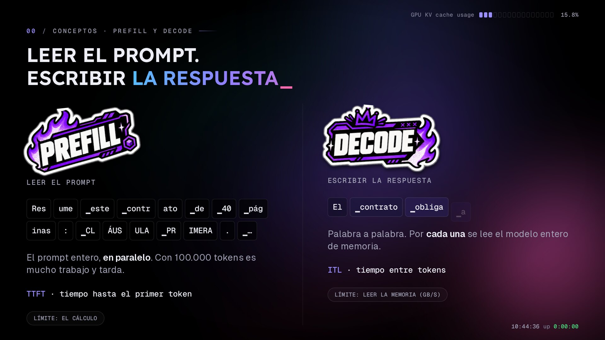
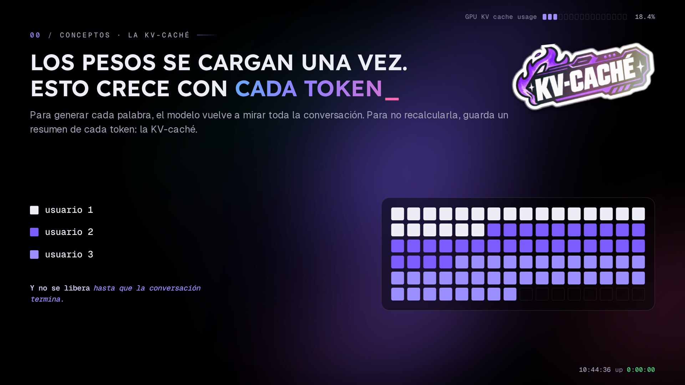
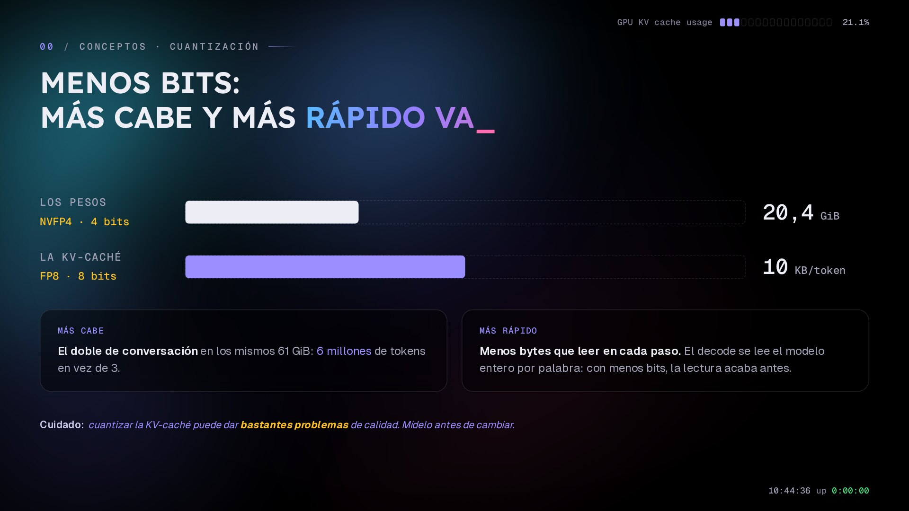
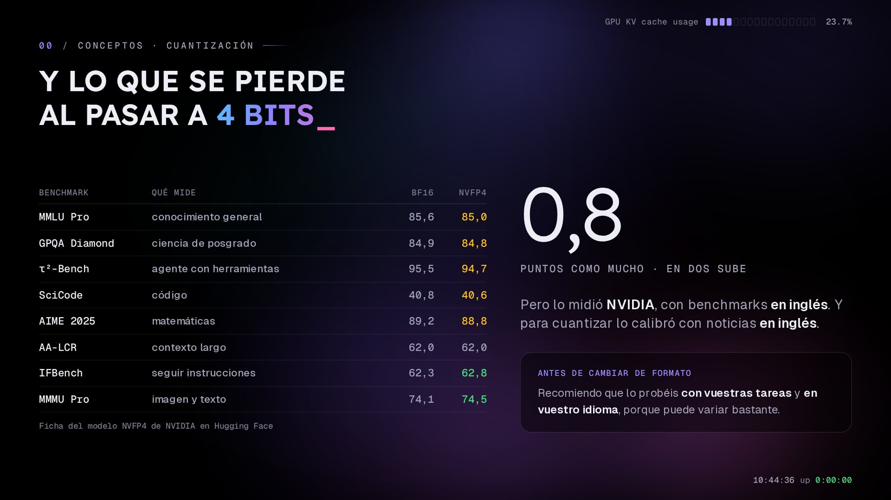
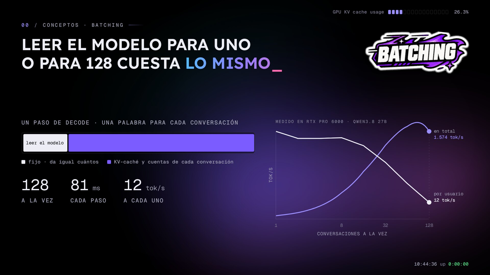
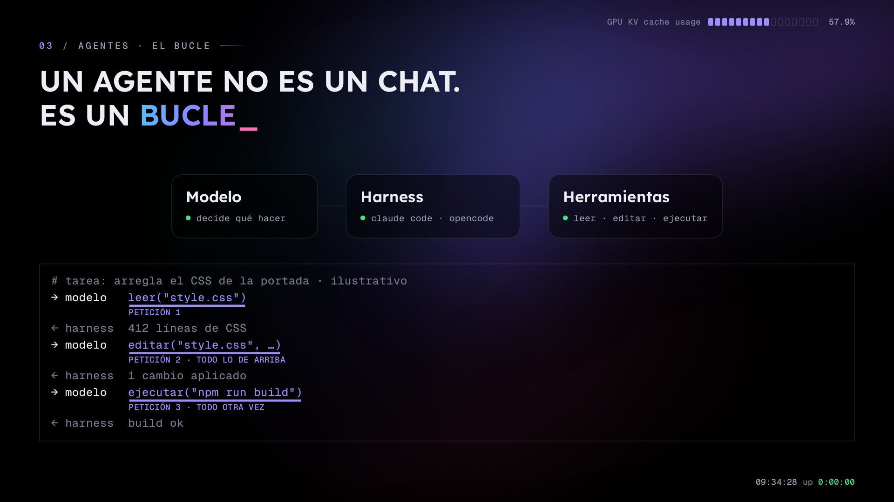
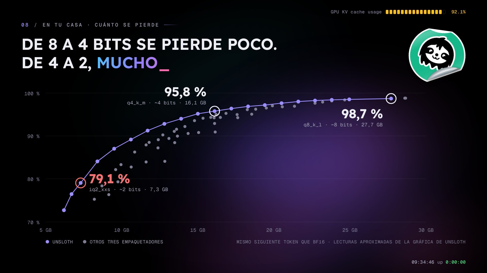

import video from './assets/peticion-de-principio-a-fin.mp4?url'
import poster from './assets/peticion-de-principio-a-fin-poster.jpg'

On Thursday I gave the talk *Gigas vs tokens: deploying an LLM on your own infrastructure* at the **[Murcia Tech Talk](https://murciatech.org)**, at CEEIM on the Espinardo campus. It's the same talk I took to AWS Community Day, extended with two new parts: what happens when the ones using the GPU aren't people but agents, and how to do the same maths on a card you can have at home.

The concepts are all here, because nothing after them makes sense without them. What's inside a 96 GB GPU, the two limits and preemptions are covered in detail in [How many users can your GPU serve? Sizing an LLM by tokens](/en/post/2026-10-19-sizing-llm-gpu-by-tokens/), so I sum that part up and focus on what's new. The full deck is at [crstian.me/talks](https://crstian.me/talks) (the slides are in Spanish).

As always, the numbers come from [Helmcode](https://helmcode.com)'s machines: production, or a test bench with the same GPU, an RTX PRO 6000 Blackwell with 96 GB, and I say which each time.

## Quick summary

- **An agent isn't a chat.** A Claude Code session is about 174 requests to the model, and each one comes in with about 100,000 tokens: forty times a chat.
- **Prefix caching is what makes agents workable.** In my production, 81 % of what comes in was already in the cache. But that cache is the first thing to go when memory runs short.
- **With agents, compute usually runs out before memory.** The dense model takes 88 s to start answering with memory at 43 %.
- **MTP speeds up writing, not reading.** With one agent it's faster; with 32, the first token takes more than twice as long.
- **At home, llama.cpp and 4-bit GGUF.** With the right model, a 16 GB card fits about 560,000 tokens: five agents or two hundred chats.

## The concepts

Before getting into the maths, five minutes of concepts that come up all the time.

### Everything is counted in tokens



A language model doesn't see words, it sees tokens: chunks of text. This is the real split with the tokenizer of the model I run in production: "¿Cuántos usuarios aguanta mi GPU?" is five words and ten tokens, and the same question in English is eight. The underscore some chunks carry is the space in front, which is glued to the word.

Tokenizers are trained mostly on English text, so other languages pay more tokens for the same thing (the rule of thumb that a token is about three quarters of a word is for English). What you send the model is the prompt and what you get back is the response, and both are counted in tokens. The context is every token in a conversation: what the user said, what the model answered, the whole history. Every model has a maximum in its `config.json`. The one I run in production takes up to 262,144.

### A model is a pile of numbers: parameters, dense and MoE

Those numbers are the parameters, or weights: the values the model learned in training. The B stands for billion, so an 8B model has eight billion parameters. They load fully into GPU memory at startup and don't change after that.

Generating a token means passing it through the model layer by layer, multiplying it by the weights. In a dense model it goes through every parameter. In an MoE (mixture of experts) each layer has many experts and a router picks a few for each token, so each token only goes through a small part of the model. It takes up memory like a big model and computes like a small one.

And each parameter takes up space depending on how you store it. The model comes out of training in 16 bits, two bytes per parameter, and quantizing means storing it with fewer bits: 8 bits is one byte, 4 bits half a byte. You lose some precision and gain a lot of memory. So how much the model takes is easy to work out: parameters × bytes per parameter.

### It's all in the model's name



The model I run in production, and the one in the whole talk, is Qwen3.6-35B-A3B-NVFP4, and its name carries exactly those three things:

- 35B is about thirty-five billion parameters: what it takes up in memory.
- A3B is the active ones, three billion. It's an MoE with 256 experts per layer, and the router picks 8 for each token. All thirty-five billion still have to stay loaded, because the next token can ask for any expert.
- NVFP4 is the quantization, NVIDIA's 4-bit format: half a byte per parameter.

Thirty-five billion at half a byte is about 18 GB, and in practice it's about 20, because not everything is in 4 bits: attention is FP8, the embeddings and the vision encoder stay in 16 bits, and every block of 16 weights stores its scale.

Since I compare against it all the time, the other one is Qwen3.8-27B-NVFP4, from the same family. It has no A because it's dense: all twenty-seven billion work on every token.

### Prefill and decode: reading the prompt, writing the answer



A request has two very different phases, and the difference matters for everything that follows:

- **Prefill** is reading what you send: the whole prompt, at once, in parallel. With a hundred-thousand-token prompt that's a lot of compute and it takes a while. How long the first word takes is called TTFT (time to first token), which is queue time plus prefill.
- **Decode** is writing the answer word by word. For every new word the GPU reads the whole model from its memory, so what limits it isn't compute but how fast memory can be read (the card's GB/s). The output pace is measured as ITL, the time between one token and the next.

### The KV cache



This is the most important concept in the talk. To generate each word, the model looks back at the whole conversation, and recomputing it every time would be painfully slow, so it keeps a summary of every token it has seen. That store is the KV cache (for key and value, the two vectors it keeps per token).

It grows with every token the user writes and every token the model answers. Every user who comes in takes their own space, and that memory isn't freed until their request finishes.

### Quantization: more fits and it goes faster



In 16 bits my 35B Qwen would take about 65 GiB. In NVFP4 it's 20.4.

The KV cache is quantized too, and that's a separate decision. In 16 bits each token would take 20 KB; I run it in FP8, at 10 KB, so the same 61 GiB hold twice as many tokens: 6 million instead of 3. For sizing, this is the one that matters most. It's also faster, because decode has fewer bytes to read on every step.

That said, quantizing the KV cache can cause real quality problems. You lose precision in what the model remembers of the conversation, and it shows more the longer it gets, so measure quality before you switch formats.

### What you lose going to 4 bits



This is the table NVIDIA publishes for my model, the same NVFP4 I run in production: eight benchmarks, in 16 bits and in 4. The biggest loss is eight tenths of a point, long context loses nothing, and two scores go up (measurement noise).

The catch is where it comes from. NVIDIA measured it with English benchmarks, and calibrated the quantization on CNN news, also in English. So the benchmark number isn't yours: before you switch formats, test it on your own tasks and in your own language, because it can vary a lot.

### Batching: reading the model for one or for 128 costs the same



On each decode step the GPU reads the model once, no matter how many conversations there are, and produces one word for each. I measured it on the test bench with the dense 27B, with 2,000-token prompts and 500-token answers:

| Conversations at once | Tokens/s per user | Tokens/s total | Each step |
|---|---|---|---|
| 1 | 64 | 64 | ~16 ms |
| 8 | ~60 | ~470 | almost the same |
| 128 | 12 | ~1,570 | 81 ms |

With eight at once the step barely grows: almost free work (like a paella for 128, lighting the fire costs the same for one as for everyone). With 128, the KV cache and each conversation's maths outweigh reading the model, every step takes about five times longer, and each person gets 12 tokens per second.

The operator sets the maximum number of conversations at once with `--max-num-seqs`. I have it at 128. It's a product decision: more people, or faster for each one.

### If you come from infrastructure, you already know how to serve this

You already know all of this under other names:

| Inference | What you already know |
|---|---|
| vLLM | the engine: a specialised gunicorn with an OpenAI API, `/metrics` and `/health` |
| LiteLLM | the API gateway in front: keys, teams and budgets |
| `max-num-seqs` | `maxConnections`: how many conversations at once |
| KV cache | each connection's session in RAM, growing with every message and not freed until it closes |
| preemption | an eviction: a conversation is kicked out to make room and goes back to the queue |
| TTFT · ITL | your latency: how long the first word takes and the gap between words |

## One request from start to finish

This slide is new in this version. It puts every concept above together in the journey of a single request:

<video
  src={video}
  poster={poster.src}
  autoplay
  muted
  loop
  playsinline
  preload="metadata"
  class="w-full rounded-xl border border-border"
  aria-label="Animation of one request: it reaches vLLM's queue, reuses the prefix cache, runs prefill and decode, and leaves its KV cache behind as cache"
></video>

1. **The agent sends the whole conversation**: the history plus what's new. That's the prompt.
2. **It waits in the queue.** The server is one machine with its CPU and its GPU. vLLM runs on the CPU, takes the request and queues it in RAM until there's room on the GPU: not all 128 slots taken, and memory left.
3. **What was already read is reused.** If the start of the request went through the GPU recently and its KV cache is still in memory, it isn't computed again.
4. **Prefill: the new part is read at once.** The GPU cores fetch the weights from memory, do the maths for all the new tokens together and store their KV cache. The first word comes out: that's the TTFT.
5. **Decode: one word per step.** On every step the cores fetch the weights once for all conversations, plus each conversation's KV cache, and produce one word for each. The pace is the ITL.
6. **When it's done, its KV cache stays** as cache, in case the next request starts the same way, until another conversation needs the space.

## The maths, briefly

Fitting the model on the GPU doesn't tell you how many people it can serve. How much one token takes comes from `config.json`: for my model it's about 10 KB, because only 10 of its 40 layers keep memory. Its dense sibling, Qwen3.8-27B, takes 34 KB per token despite being smaller.


On the same GPU, that's 6.08 million tokens of conversation with one and 1.9 million with the other. And there are two limits, both measured in tokens: how many fit (memory, you calculate it) and how many there's time to process (compute, you measure it). The full maths is in the [AWS Community Day post](/en/post/2026-10-19-sizing-llm-gpu-by-tokens/).

## An agent isn't a chat



An agent is a model inside a loop. The model decides what to do, and a program around it, the *harness* (Claude Code, OpenCode, whichever), runs it with its tools and hands back the result.

Asking it to fix the CSS on a landing page is several requests in a row: one to read the file, another to edit it, another to check the build. And each one carries everything before it: the instructions, the whole file and what the model has reasoned so far. For the server, a one-sentence task is dozens of requests, each with the whole conversation in front.

### How many requests


I'm not making this up: there's a public dataset of real Claude Code sessions, published by SemiAnalysis and Weka, and it's the one I used on the test bench.

| | |
|---|---|
| Sessions | 393 |
| Requests to the model | 68,266 |
| Requests per session | ~174 |
| Sent by subagents | 58 % |
| Input tokens per request (mean) | ~101,000 |

A regular chat brings about 2,500 tokens. An agent's request, forty times that. So before asking how many users fit on a GPU, ask whether they're people or agents. My production has both: half the requests bring fewer than 2,000 tokens, and almost one in four goes over 50,000.

### What was already read isn't read again


What saves agents is that every request looks a lot like the previous one: everything from before, plus a new bit. vLLM takes advantage of that with **prefix caching** (`--enable-prefix-caching`): if it processed the start of the request recently, it reuses that KV cache and only runs prefill on the new part.

In my production, over a week, **81 % of what comes in was already in the cache**. Only one part in five has to be read.

The catch is where that cache lives: in the part of the KV cache left free by the conversations in flight. When they need room, the cached prefixes are the first thing thrown away. And then every turn of the agent reads its hundred thousand tokens again, which is exactly the compute work that costs the most.

## With agents, compute runs out first

In the previous post I showed how a short question went from 7 seconds to almost 10 minutes on the test bench, and that the first part of that climb happened with memory half full and no preemptions. What ran out was GPU time: every long conversation has to be read in full before answering.


With real production traffic replayed on the bench, same GPU and same flags, the first token (p99):

- **Dense, Qwen3.8 27B**: 88 seconds, with memory at 43 % and zero preemptions.
- **MoE, Qwen3.6 35B-A3B**: 23 seconds, with memory at 8 %.

And with **24 real coding-agent sessions** at once, the dense model gives each user 3 tokens per second, which is useless. The MoE gives 30. Only 3 billion parameters work on each MoE token, so it wins twice: less memory per token and less compute per token.

## MTP speeds up writing, not reading


The same question always comes up: what if I turn on MTP? It's speculative decoding: the model guesses several words ahead and then checks them all at once. The new Qwen models ship with it. I measured it on the bench with the dense 27B:

| | Without MTP | With MTP |
|---|---|---|
| 1 agent, tokens/s while writing | 60 | 87 |
| 32 agents, first token (p50) | 42 s | 109 s |
| Tokens that fit in the KV cache | 1,905,817 | 1,700,274 (−11 %) |

With one agent, it speeds up decode. With many, the guesses burn compute, which is exactly what was already short, and the first token takes more than twice as long. On top of that, the MTP weights take 11 % of the room away from conversations.

So MTP helps when what you lack is writing speed (few users, long answers) and gets in the way when what you lack is compute (many agents, long context). On the MoE, with one or two users, it even slows things down: it already wrote so fast that it went from 220 to 162 tokens per second. I don't run it in production, which is my many-agents case, and it also broke tool calling there.

## At home

The other new half of the talk: the same maths, on a regular graphics card.

### The engines: serving people or running at home


| Serving people, in production | At home |
|---|---|
| **vLLM**: the one this talk is about. Batching, paged KV cache and prefix caching | **llama.cpp**: the engine behind almost everything local. Runs on a gaming GPU, on CPU or on a Mac |
| **SGLang**: very similar, very good at reusing prefixes | **Ollama**: llama.cpp underneath, with one command |
| **TensorRT-LLM**: NVIDIA's, the fastest on their cards and the hardest to set up | **LM Studio**: a desktop app with its own chat window |
| Hugging Face format (safetensors), quantized for the GPU: FP8, NVFP4 | **GGUF**: the quantized model packed in a single file |

The best part for infrastructure people: they all serve the same API, OpenAI's. Swap the engine and your app doesn't notice.

### How much GGUF loses



Unsloth measured the GGUF files of the dense 27B. Each dot is a file: further right, bigger; higher up, closer to the original. What it measures is how often it picks the same next word as the 16-bit model, not how many tasks it solves.

| Quantization | Size | Same as BF16 |
|---|---|---|
| Q8 (~8 bits) | 27.7 GB | 98.7 % |
| Q4_K_M (~4 bits) | 16.1 GB | 95.8 % |
| IQ2_XXS (~2 bits) | 7.3 GB | 79.1 % |

From 8 to 4 bits you lose three points for half the memory: almost free. From 4 to 2, twenty points. The curve isn't a straight line: below about 3 bits it falls off a cliff. At home, **4 bits is the sweet spot**. Bear in mind it's one packager's chart, not an independent test.

### The same maths on a 16 GB GPU


For home I don't pick the 27B. I pick a small, widely downloaded one, **Ornith 1.5 9B, in Q4_K_M**, and run the same recipe:

1. **Weights**: a 5.78 GB file, about 5.4 GiB on the card.
2. **Engine and state**: around 1 GiB, plus half a GiB of headroom. That's an estimate: check your own log.
3. **Conversations**: 9.1 GiB left.
4. **Memory per token**: its `config.json` says 32 layers, and only 8 keep memory (`layer_types`), with 4 KV heads of 256. With the cache in `q8_0` (32 values in 34 bytes):

   ```
   2 × 8 × 4 × 256 × 34/32 = 17,408 bytes ≈ 17 KiB per token
   ```

   Half of the dense 27B.
5. **Tokens that fit**: 9.1 GiB ÷ 17 KiB ≈ **560,000 tokens**.

For how many people? Five agents of 100,000 tokens at once, or about two hundred chats. On a gaming card. Picking the right model matters more than the card.

### What to run it with

At home, llama.cpp. These flags are the maths above: the file, half a million tokens split across five conversations of a hundred thousand, and the KV cache in `q8_0`:

```bash
llama-server \
  -hf ornith-ai/Ornith-1.5-9B-GGUF:Q4_K_M \
  --ctx-size 500000 --parallel 5 \
  --cache-type-k q8_0 --cache-type-v q8_0
```

With `--parallel`, llama.cpp splits the context across those conversations. It does continuous batching, but without vLLM's paged KV cache or scheduler: it's built so the model fits, not for lots of users.

Serving people, vLLM. These are my production flags:

```bash
vllm serve /models/qwen3.6-35b-a3b-nvfp4 \
  --max-model-len 262144 \
  --max-num-seqs 128 \
  --kv-cache-dtype fp8 \
  --enable-prefix-caching
```

## The recipe, again

Five steps. You calculate the first three and measure the last two:

1. **Weights**: parameters × bytes per parameter, from the model name.
2. **Memory per token**: from `config.json`, checking how many layers keep memory.
3. **Tokens that fit**: what's left on the GPU divided by memory per token, or the `GPU KV cache size` line in the vLLM log.
4. **Users**: tokens that fit divided by tokens per user. And before that, find out whether they're people or agents.
5. **Tokens per second**: load the GPU with your longest conversations (with [AIPerf](https://github.com/ai-dynamo/aiperf), for example) and watch the first token. If it shoots up before memory fills, your limit is compute.

## FAQ

### How many requests does an agent like Claude Code make?

In a public dataset of 393 real Claude Code sessions, the average is about 174 requests per session, with about 101,000 input tokens each. More than half are sent by subagents.

### What is vLLM's prefix caching?

Reusing the KV cache for the start of a request when it was processed recently, so prefill only runs on the new part. With agents it's what helps most: in my production, 81 % of input tokens were already in the cache.

### Is MTP worth turning on?

With few users and long answers, yes: it speeds up writing. With many agents and long context, no: it burns compute, delays the first token and takes memory away from conversations.

### llama.cpp or vLLM?

llama.cpp to run a model at home, on any GPU, CPU or Mac, with few users. vLLM to serve lots of people at once on server GPUs. Both speak the OpenAI API.

### Which GGUF quantization should I pick?

Q4_K_M is the sweet spot: half the memory of 8 bits for very little loss. Below 3 bits quality drops off a cliff.

### How much VRAM do I need to run an LLM locally?

Enough for the weights, plus the KV cache of the conversations you want open, plus a bit for the engine. With a 9B model in Q4_K_M, a 16 GB card fits about 560,000 tokens of conversation.

---

If you want to see this running with lots of people on it, drop by [NaN](https://nan.builders), and if you sign up with <a href="https://cloud.nan.builders/r/76AS6C80?lang=en" target="_blank" rel="sponsored noopener noreferrer">my referral link</a> you get 5 % off your first month. And thanks to [Murcia Tech](https://murciatech.org) for having me.
