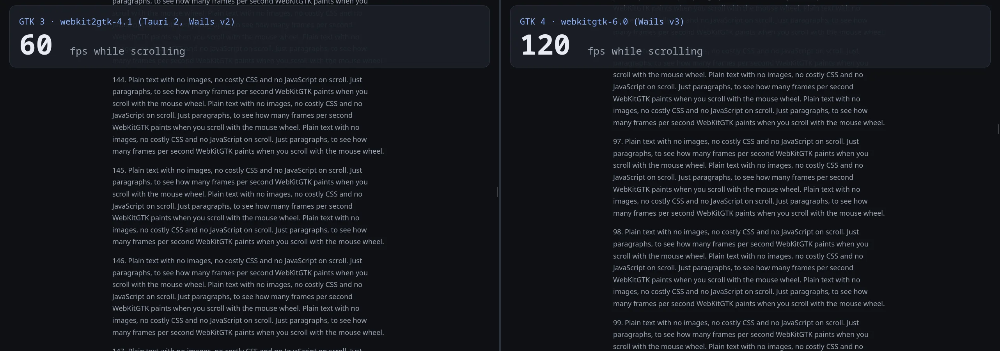
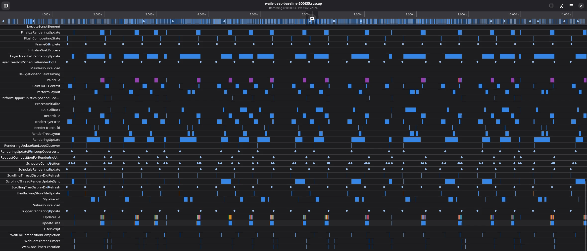
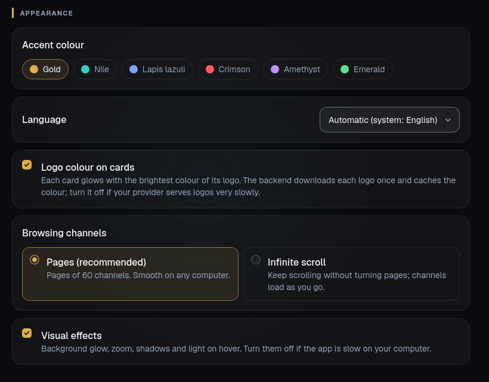

I wanted to build my first desktop app and couldn't choose between two frameworks: [Tauri 2](https://tauri.app/) (Rust) and [Wails](https://wails.io/) (Go). Both work the same way, a native backend plus a web UI inside the system WebView, without shipping a whole Chromium like Electron. Since I couldn't decide, I built it with both.

The app is Herakleo, an IPTV desktop player for Linux, Windows and macOS (the comparison is Linux only). You give it M3U playlists or Xtream Codes accounts, it shows the channels in a grid, and each channel opens in [mpv](https://mpv.io/). Both versions shared the same Svelte 5 frontend, so only the backend changed, which let me compare Wails vs Tauri on a real app instead of a hello world. The Tauri version is gone from the repo now: I removed it after v0.1.0 and it lives on in the git history.

I went with Wails, now on Wails v3 and GTK 4. What decided it wasn't Go versus Rust. It was the web engine both frameworks use on Linux, which no comparison on paper had mentioned.


## Quick summary

- **Rust wins on the backend, and it doesn't matter.** It's 2–4× faster than Go on text scans, but every call stays far under one frame, so the UI feels the same.
- **On Linux, Tauri 2 and Wails v2 use the GTK 3 port of WebKitGTK.** That port doesn't scroll faster than 60 fps, even on a 120 Hz monitor.
- **Wails v3 uses the GTK 4 port and scrolls at 120 fps.** Tauri has no way to do that on Linux today.
- **A rebuild after a one-line change takes 57 s with Tauri and 0.6 s with Wails.** With an LLM writing the code, that matters more than any backend difference.
- **Tauri wins on size, memory, ecosystem, mobile and security defaults.** If I needed one of those, I'd pick Tauri.

## Why I built it twice

Each one had its case. Wails, because I know Go. Tauri, because an LLM was going to write the code, not me, so my Go mattered less, and Tauri has more ecosystem (plugins, bundler, updater, mobile), more examples online and a reference app of the same kind: Fred TV (formerly Open TV) is built with Tauri. On paper Tauri won, but as my first desktop app I didn't have the experience to decide from reading alone, so I built both and measured.

The frontend is shared, so building the app twice only costs the backend, about 2,400 lines per language, not counting tests. To keep the comparison fair, the boundary is a TypeScript contract (`frontend/src/lib/types.ts`) that both backends implement, and each one has a small adapter. Same tests, same files on disk, and a benchmark that runs inside the apps themselves.

Video doesn't play in the WebView. WebKitGTK doesn't decode MPEG-TS and mpv handles everything, so each channel opens in an external player. That keeps video out of the comparison and leaves what matters here: loading huge playlists and moving through them.

## The test: 65,081 real channels

Everything was measured on my machine: CachyOS with Hyprland, Ryzen 7 5700X, Radeon RX 6800 and a 120 Hz monitor. The library is real: one M3U playlist with 65,081 channels, 17 MB of JSON cache.

```bash
just bench   # starts both release apps on a copy of the library and measures from inside the webview
```

This is one machine and my playlist. On other hardware the memory and startup numbers will change.

## Backend: Rust wins, and it doesn't matter

Library code only, no UI (median):

| Operation | Go | Rust |
|---|---:|---:|
| Load the library (17 MB of JSON) | 52–62 ms | 27–32 ms |
| First page of channels | 1.1 ms | 0.3 ms |
| Search | 1.5 ms | 0.7 ms |
| A→Z sort (one page) | 0.5 ms | 1.4 ms |

Rust is 2–4× faster on text scans. In the UI you can't tell: everything lands far under one frame (16.7 ms at 60 Hz).

The best part is that the LLM wrote the same bug in both languages. The first version re-sorted all 65,000 channels for every page of the infinite scroll: 137 ms per page in Go and 31 ms in Rust. Search also lower-cased every channel name on every query. With the A→Z order cached and the lower-case key computed once at load, both dropped to 0.5–1.4 ms. The fast language hid the problem, it didn't fix it.

## Inside the app, which is what users notice

| | Tauri 2.12 (GTK 3) | Wails v2 (GTK 3) | Wails v3 (GTK 4) |
|---|---:|---:|---:|
| Start → window | ~235 ms | ~245 ms | ~230 ms |
| Start → channels on screen | ~575 ms | ~720 ms | ~510 ms |
| Call from the UI (bridge + backend) | ~1.0 ms | ~1.7 ms | ~2.0 ms |
| Scroll (median frame time) | 17 ms ≈ 60 fps | 17 ms ≈ 60 fps | **8–9 ms ≈ 120 fps** |
| Peak memory (app + WebKit processes) | ~640 MiB | ~690 MiB | ~715 MiB |
| Binary | 7 MB | 11 MB | 13 MB |

The bridge between UI and backend costs the same in both, about 0.7–0.8 ms per call, so the difference between them is the backend code, not the bridge. Most of the startup time is WebKit: loading the 17 MB of channels is 30–60 ms out of about 500–700.

## Tauri on Linux stays at 60 fps: the limit is GTK 3 WebKitGTK

The monitor runs at 120 Hz and both apps scrolled at 60. I ruled things out one by one:

1. **The app isn't capped.** At idle, `requestAnimationFrame` ran at 120 fps in both.
2. **It isn't my CSS.** Removing logos, card backgrounds or `content-visibility` changed nothing.
3. **It's WebKitGTK.** I opened the `MiniBrowser` that ships with each WebKitGTK API on a plain text page:

```bash
/usr/lib/webkit2gtk-4.1/MiniBrowser   # GTK 3: 59 fps while scrolling
/usr/lib/webkitgtk-6.0/MiniBrowser    # GTK 4: 125 fps while scrolling
```

Same WebKit release, a page of plain text, and the GTK 3 port stops at 60 while the GTK 4 port reaches 120.



This is where it gets confusing, because Linux has two [WebKitGTK](https://webkitgtk.org/) APIs:

| Package (Arch) | Toolkit | Used by |
|---|---|---|
| `webkit2gtk-4.1` | GTK 3 | Tauri 2, Wails v2 |
| `webkitgtk-6.0` | GTK 4 | Wails v3, GNOME Web |

Tauri 2.12 runs on [wry](https://github.com/tauri-apps/wry) 0.57, which only has a GTK 3 backend. Wails v2 also links `webkit2gtk-4.1`. Wails v3, stable since 26 October, builds against GTK 4 and `webkitgtk-6.0` by default (a `gtk3` build tag switches back). As of late October the move to GTK 4 still hasn't landed: there's an [open PR in wry](https://github.com/tauri-apps/wry/pull/1767) and Tauri has it planned [for 3.0](https://github.com/tauri-apps/tauri/issues/14684).

So I moved the Go backend from Wails v2.17 to v3.0.0. It took a while (`main`, the service, the dialogs and the JS adapter), and scrolling went from 17 to 8–9 ms per frame, about 120 fps. To check it links what it should:

```bash
ldd wails/build/bin/herakleo | grep -E 'webkit|gtk'   # webkitgtk-6.0, gtk-4
```

With Tauri there's no way to do this on Linux today.

### Wails v3 vs v2

I also liked v3 more than v2. It doesn't need a CLI (`go build -tags production` is enough), the backend is exposed as services, and each method can take the `context.Context` of its call, which is cancelled if the UI drops it.

## "WebKitGTK is abandoned, Tauri shouldn't use it"

A friend told me this while we were talking about it, and I think it needs some nuance.

**It isn't abandoned.** Igalia and GNOME maintain it, it ships two stable releases a year (2.54 came out in September 2026, with the compositor moved to Skia) and it publishes security advisories regularly.

**What is true:** the team is much smaller than Chromium's, it's behind on performance and on some APIs, and every distro ships a different version, so the app behaves differently depending on where you install it.

Tauri's problem on Linux isn't WebKitGTK. It's staying on its GTK 3 API, the old part of the project. The alternative, bundling Chromium (CEF), adds about 150 MB per app and takes you close to Electron, which is exactly what Tauri wants to avoid.

## A friend tries it: "scrolling isn't smooth"

Later I gave the Arch package to a friend to try. Opening the side menu was smooth, scrolling wasn't: too much CSS, go profile it. Then I noticed it on my PC too.

My benchmark missed it because it scrolled the grid from code, with no mouse over it. A person uses the wheel with the cursor over the cards, and every card that slides under the cursor triggers its `:hover`.

### Measuring with a real wheel: ydotool and sysprof

I wrote a script (`just profile-scroll`) that starts the app on a copy of the library, puts the cursor over the grid and sends real wheel events with [ydotool](https://github.com/ReimuNotMoe/ydotool). The app records frame times only while scrolling, and with `--sysprof` it also captures the WebKit and GTK marks for each frame with [sysprof](https://gitlab.gnome.org/GNOME/sysprof).

A warning if you use sysprof: the capture stores the environment of whoever launches it, with all your variables, tokens and keys included. My first two captures are never leaving my PC, and the script now starts it with a minimal environment.



### First culprit: hover transitions

With a real wheel and the cursor over the grid, Wails v3 dropped to 24 ms per frame, about 42 fps. I removed suspects one at a time:

| Variant (real wheel, cursor on the grid) | Median | p95 | Frames > 33 ms |
|---|---:|---:|---:|
| As is | 24 ms (~42 fps) | 31–34 ms | 1–5 % |
| No transitions on cards | 9 ms | 25 ms | 1 % |
| No hover shadow | 10–12 ms | 26–28 ms | 1–2 % |
| No logos | 24 ms | 27–28 ms | 1–2 % |
| Flat cards | 8 ms | 19 ms | 0 % |
| No `content-visibility` | 32 ms | 42 ms | 30–43 % |

Every card that passed under the cursor started its transitions: a `box-shadow` with 48 and 100 px of blur, `border-color` and `transform`. Shadows can't be animated on the GPU, so WebKit repainted on every frame of every transition, and with the wheel there are always several running.

sysprof confirmed it. Without the transitions, `RenderingUpdate` p95 went from 14 to 10 ms, `LayerTreeHostRenderingUpdate` p95 from 17 to 13 ms, `PerformLayout` from 288 to 110 runs and `PaintTile` from 15,800 to 9,000 tiles. At 120 Hz you get 8.3 ms per frame. If the main thread goes over, you miss two refreshes: 3 × 8.3 ≈ 25 ms, which is exactly the median I was seeing.

The fix:

1. Cards only animate `transform`. The shadow and the border change instantly.
2. While the grid scrolls (and for 150 ms after), cards ignore the pointer, so hovers don't start as cards slide under the cursor:

```css
.is-scrolling .card {
  pointer-events: none;
}
```

3. The spotlight that follows the cursor writes its CSS variables at most once per frame.
4. `content-visibility: auto` stays. Removing it was the worst variant of all.

Same test, from 24 to 9 ms (~110 fps). Tauri, with exactly the same fix, stays at 17 ms: the GTK 3 ceiling.

### Second culprit, the big one: the DOM grew without limit

Scrolling far into new channels was still slow, at a few fps. Here I got the method wrong before finding the problem, and I'd say it's the most useful part of this post.

Comparing variants, the runs didn't scroll the same distance. When the infinite scroll didn't load pages in time, the wheel hit the end, less got painted and the number looked better. A couple of "improvements" I measured that way (19,700 px against 29,000) weren't reliable. I fixed it by preloading about 1,500 cards before measuring, so every variant scrolls exactly 31,125 px.

Then the real problem showed up. With 1,560 cards in the page, **every** variant took 600–700 ms per frame, with logos or without. With 840 cards it was 17 ms. The infinite scroll added cards and never removed the ones above, so the further down you went, the worse it got.

The fix was to virtualise the grid. Only rows within 800 px of the viewport are rendered (60–90 cards), with spacers above and below. The cards are square, so the row height comes from the grid's column width plus the gap, with no measuring.

| Long scroll (31,125 px, empty caches) | Median | p95 | Frames > 33 ms | Cards in the DOM |
|---|---:|---:|---:|---:|
| Before virtualising | 600–700 ms | ~700 ms | 92–100 % | 1,560 |
| Wails v3, virtualised | **16–17 ms** | **19 ms** | **0 %** | 80–85 |
| Tauri, virtualised (GTK 3) | 17 ms | 34 ms | 13 % | 80 |

Two more paint changes don't move the median but cut the spikes, to about 13 slow frames per run instead of about 140:

- `decoding="async"` on logos, so WebKit decodes them off the main thread.
- The card edge drawn as an inset `box-shadow` instead of a `border` with rounded corners. With hundreds of cards coming in per second, that 1 px border cost about 3 ms per frame. An inset shadow or a rounded background costs nothing measurable.

Last, I added two settings for slower machines: pagination by default (pages of 60 channels) instead of infinite scroll, and a visual effects switch. On the long scroll, effects on runs at 16 ms (60 fps) and effects off at 9–10 ms (~110 fps). On a normal scroll or a 60 Hz screen it makes no difference.




### What I took from the profiling

- **"Too much CSS" was true, but not all of it.** Logos and backgrounds didn't matter. The expensive part was animating properties that don't run on the GPU.
- **Measure with real input** (wheel, cursor over the grid), not a synthetic scroll.
- **Test real paths:** scroll far, with empty caches, not the same 240 channels every time.
- **Make conditions equal before comparing.** Otherwise the variant that does less work wins.
- **The first culprit isn't always the main one.** The hover was real, but the big problem was the size of the DOM.

## Building: 57 seconds against 0.6

This is the difference I've noticed most day to day:

| | Tauri (Rust, release with LTO) | Wails v3 (Go) |
|---|---:|---:|
| Clean build | 1 min 33 s | 20 s |
| Rebuild after a one-line change | **57 s** | **0.6 s** |
| Tooling | `cargo` + Tauri CLI (npm) | just `go build` |

With an agent writing code, the change, build, test loop runs dozens of times per session, so 57 seconds per loop hurts a lot more than any backend performance gap. (How much load an agent like that puts on a GPU is in [Gigabytes vs tokens](/en/post/2026-10-23-gigas-vs-tokens-agents-local-llm/).)

There's also something no table shows: I can read the Go and fix it myself when the LLM gets stuck.

## What Tauri does better

To be fair, Tauri wins on quite a few things:

- **It's lighter:** a 7 MB binary, less memory, and it starts slightly faster than Wails v2.
- **Faster backend** in raw terms, as shown above.
- **Ecosystem:** official plugins (`dialog`, `store`, `sql`, `updater`…), a bundler for `.deb`, `.rpm` and AppImage, and mobile (Android and iOS).
- **Secure by default:** CSP and a *capabilities* system that limits what the webview can ask for. Wails has nothing equivalent, so I did it in the backend: players come from a closed list and external links open by ID, never from a URL the UI sends.

Not everything was a difference. The LLM made the same mistakes in both languages, the sorting one and the security ones: stream URLs not validated before being passed to mpv, and Xtream passwords that could leak into logs or the window title.

## So, Wails or Tauri on Linux

For my first desktop app I'm sticking with Wails v3. On raw backend performance Rust wins, but the difference you can see comes from the web engine. Wails v3 uses the GTK 4 WebKitGTK and scrolls at 120 fps, while Tauri is still on the GTK 3 one and stays at 60. Add builds in under a second instead of a minute, and for me it isn't close.

A bonus I wasn't looking for: the same Go code builds for Windows and macOS, and CI ships 8 packages on every release (Arch, deb, rpm, Flatpak, a Windows installer and a universal `.dmg` for Mac).

I'd pick Tauri if I needed mobile, the smallest possible binary or its permissions system. Or once wry moves to GTK 4, and then I'll run the comparison again.

If you want to look at it:

- Herakleo source code, GPL-3.0-or-later: [github.com/crstian19/herakleo](https://github.com/crstian19/herakleo)
- Install it: `paru -S herakleo-bin` on Arch, or your system's package from the [releases](https://github.com/crstian19/herakleo/releases/latest)
- Wails: [wails.io](https://wails.io/)
- Tauri: [tauri.app](https://tauri.app/) and its WebView layer, [wry](https://github.com/tauri-apps/wry)
- WebKitGTK: [webkitgtk.org](https://webkitgtk.org/)
- `content-visibility`: [MDN](https://developer.mozilla.org/en-US/docs/Web/CSS/content-visibility)
