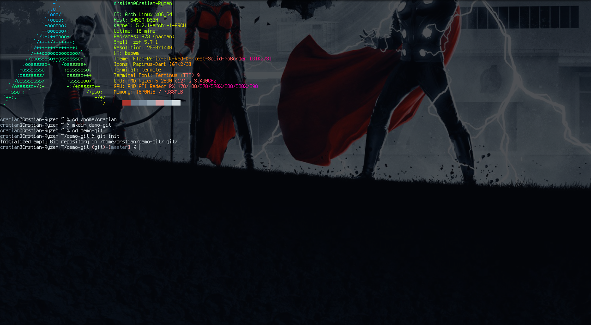
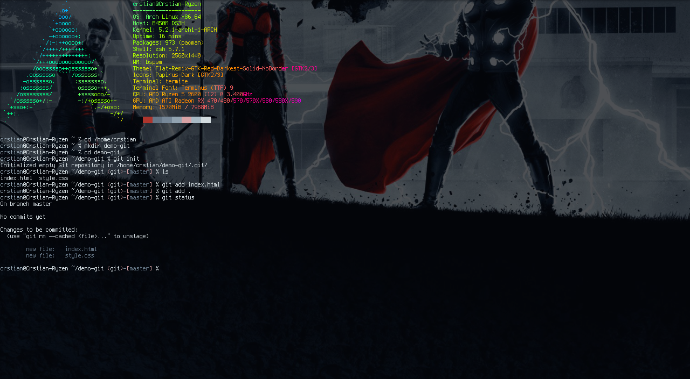
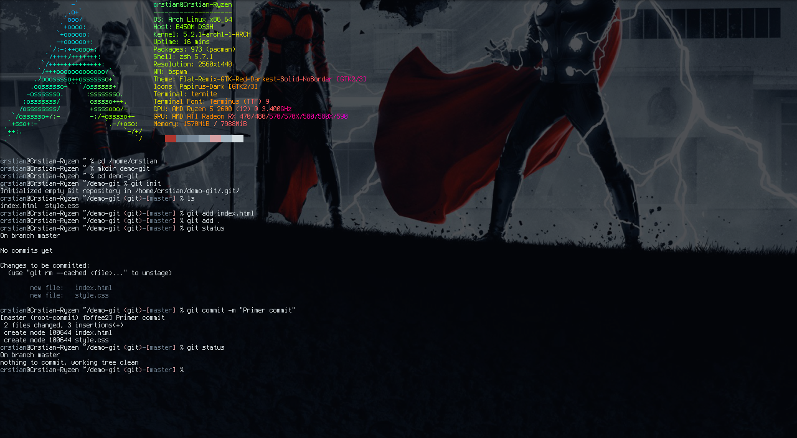
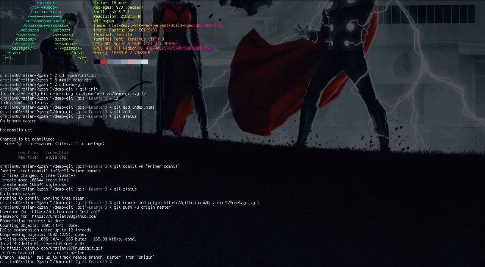

En este post vamos a ver como crear nuestro primer repositorio y tener nuestro código ordenado en Github. Vamos a aprender lo básico y los comandos necesarios para ello, por eso lo he titulado github para noobies o dummies como yo.

## Introducción

Git es el sistema de control de versiones más popular y con razón. En este post, repasaremos los conceptos básicos de qué es git y cómo usarlo dentro de la línea de comandos. Examinaremos y trabajaremos con todos los comandos básicos y más importantes, como add, commit, push...

Git es una tecnología de control de versiones esencial para desarrolladores y programadores.

Un sistema de control de versiones nos permite rastrear el historial de una colección de archivos. Estas versiones se almacenan en un lugar específico, normalmente llamado repositorio.

## Requisitos previos

Si tienes una cuenta de GitHub y has instalado y configurado Git en tu ordenador, salta al siguiente paso.

Si no tienes una cuenta de GitHub, ve [**aquí**](https://github.com/join) y regístrate para obtener una gratis. Mira cómo instalar y configurar Git [**aquí**](https://help.github.com/articles/set-up-git/). Necesitamos la herramienta con terminal en caso de encontrarnos en windows. Sigue los enlaces para descargarlo e instalarlo.

Puedes verificar si Git está instalado usando el siguiente comando:
    
> git--version

## Creando nuestro primer repositorio

En nuestro pc vamos a crear una carpeta para nuestro proyecto.
Le llamaremos por ejemplo demo-git.

Mediante la consola de comandos nos movemos a dicha carpeta y añadimos un repositorio local usando el siguiente comando:

> git init

Con este comando simplemente inicializamos un repositorio local vacío,ahora nuestra carpeta está inicializada como un repositorio Git y podemos hacer todas las cosas de git en ella.

## Añadir archivos a nuestro repositorio local

Después de que hayamos estado trabajando en nuestro proyecto y creado algunos archivos, es el momento de  preparar dichos archivos para subirlos.

Por ejemplo vamos a añadir los archivos llamados index.html y style.css.

Para añadir cada archivo por separado usamos el siguiente comando:

> git add index.html

En caso de querer añadir los dos archivos a la vez:

> git add index.html style.css

Por último en caso de querer añadir todas los archivos contenidos por la carpeta:

> git add .

Para ver los archivos que hemos añadido podemos usar el siguiente comando:

> git status

## "Commitear" los cambios

Después de añadir esos archivos al área de preparación, podemos crear un punto de control llamado commit. Cada commit se crea generalmente después de que hayamos terminado de trabajar en una determinada característica o de arreglar un determinado error. Estos commits pueden ser usados para controlar qué características fueron agregadas en qué commits y por quién, así que podemos controlar fácilmente o incluso revertir el commit completo si hay algún error en el código.

Una commit en un repositorio  podríamos decir que es como un gigantesco copiar y pegar, ¡pero aún mejor!

Para añadir un commit usamos el siguiente comando:

> git commit -m "commit message"
  
  La -m significa que vamos a añadir un cierto mensaje.
  

En este ejemplo, vamos a crear nuestro primer committ.Vamos a hacer una confirmación con el mensaje "Primer commit".

Podemos hacerlo escribiendo git commit -m "Primer commit".

El mensaje del commit debe indicar qué cambios de código se hicieron en ese commit en particular.

## "Pushear" tus cambios en tu master branch
  
Cuando todos los archivos son agregados y confirmados, lo único que queda por hacer es "pushearlos/subirlos" a nuestro repositorio remoto.

Pero antes de eso tenemos que por así decirlo ligar nuestro repositorio local a nuestro repositorio en github con el siguiente comando:

> git remote add origin (Link de nuestro repo)

La primera vez que hagamos push en los archivos a un directorio remoto, tenemos que ejecutar el siguiente comando:
  
  > git push -u origin master
  

A partir del segundo push ya solo tendremos que ejecutar lo siguiente:
  
 > git push

Algunos comandos que también nos pueden ser útiles:

Listar todas las branches

> git branch

Cambiar entre diferentes branches

> git checkout -b <branch name>

Revertir los cambios del último commit

> git revert<commit-id>

  
### ¡Eso es todo!

Espero que te haya servido como introducción para crear tu primer repositorio. 😉
