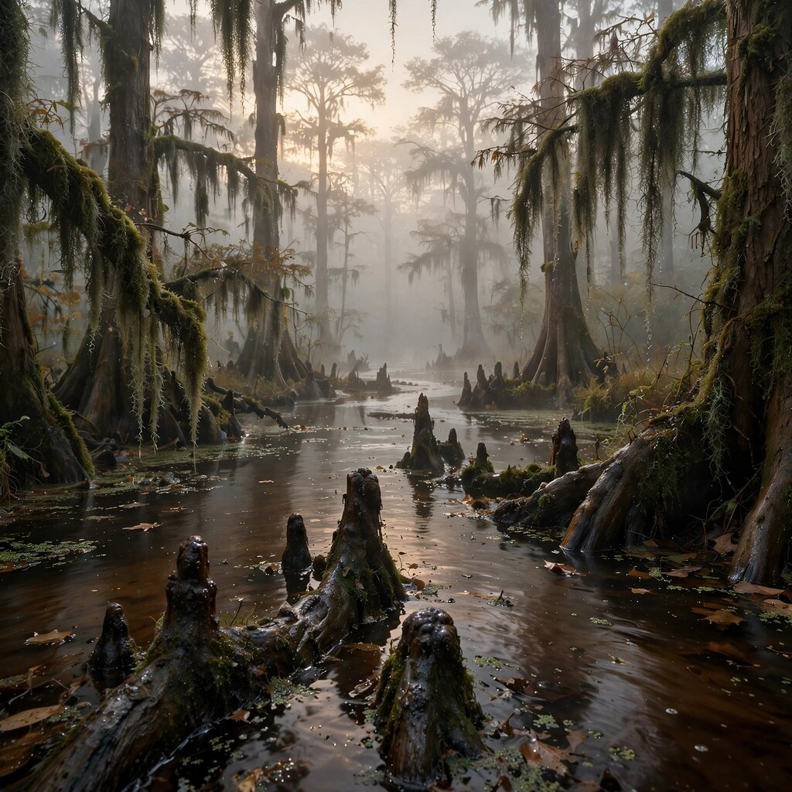
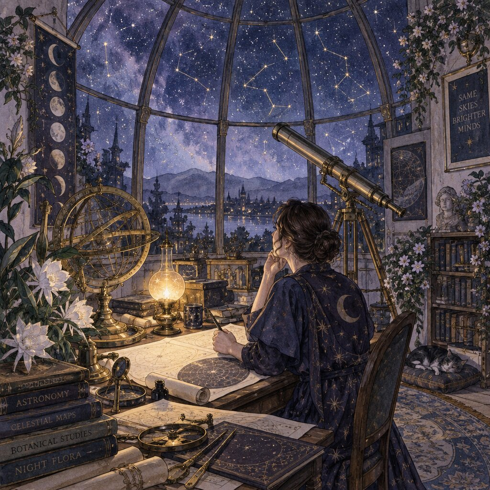
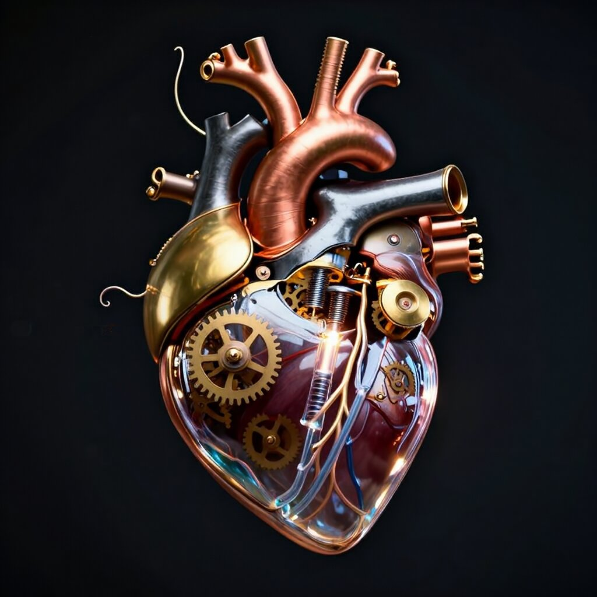
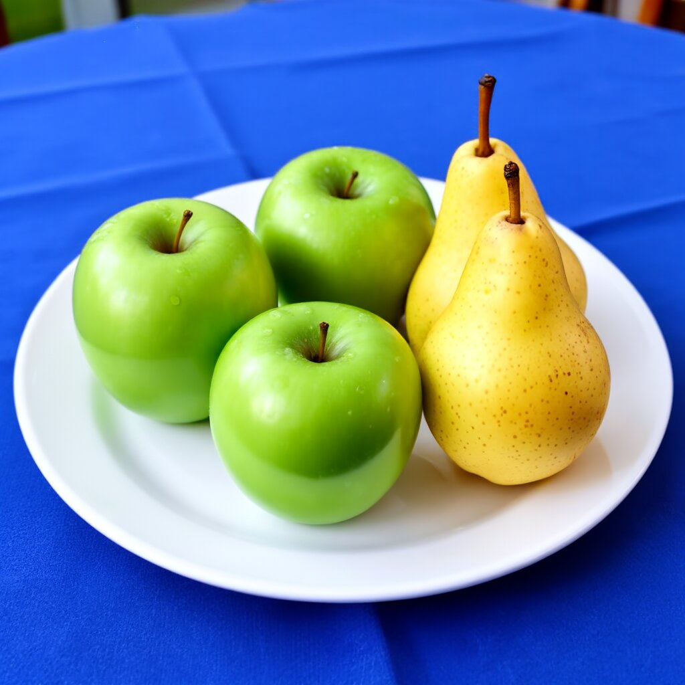
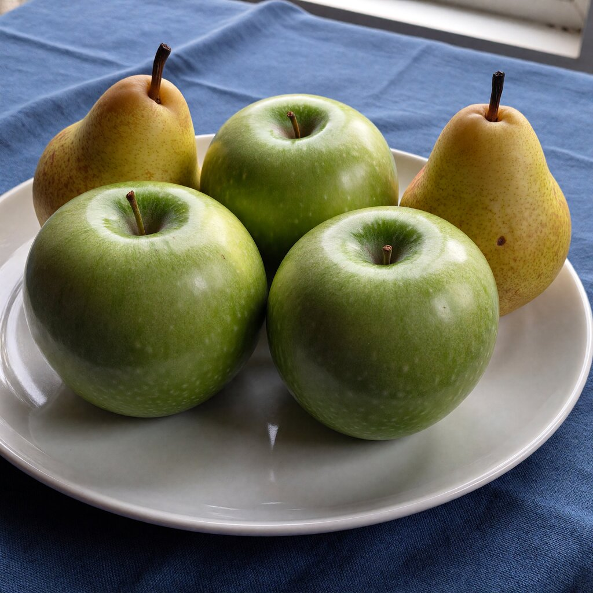
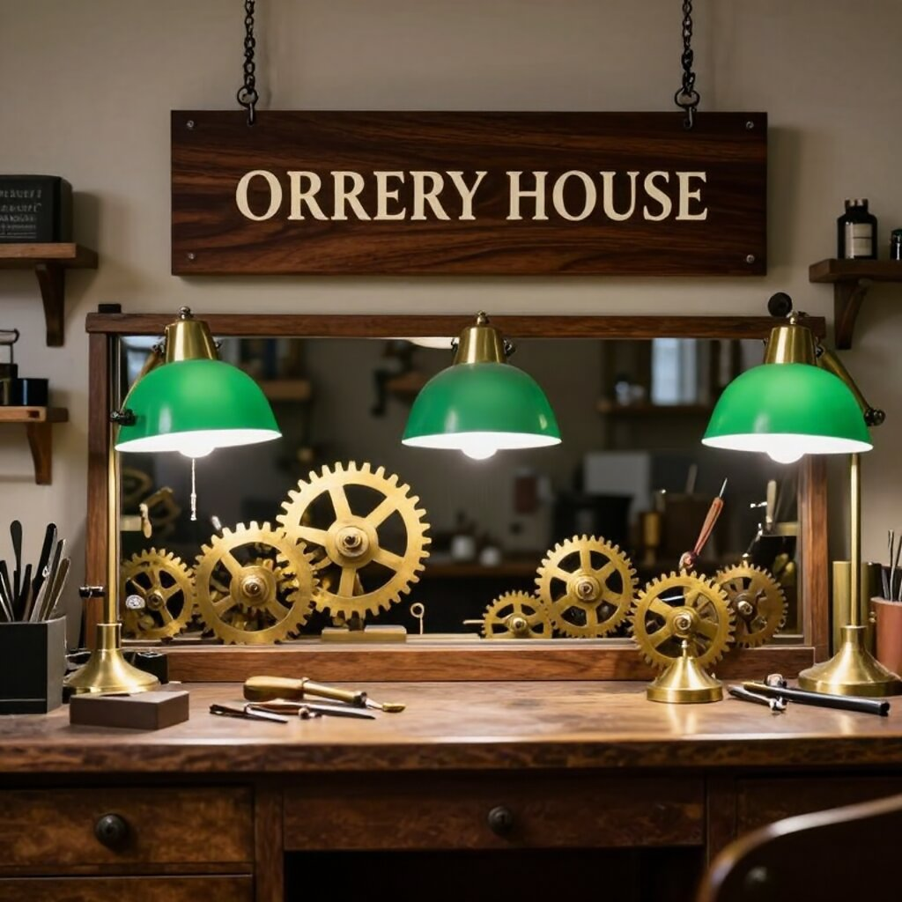

Esta semana ha salido un modelo de imagen abierto made in 🇪🇸, **Iris-3B**, de solo 3B parámetros. Lo he montado en una GPU y lo he puesto contra GPT Image, FLUX y compañía con los mismos prompts.

Una imagen por prompt, sin mucha historia. Os dejo aquí los resultados, que en el [hilo de Twitter](https://x.com/crstiax) no caben los prompts ni los detalles.

Antes de que nadie se me tire al cuello: sé que no es una comparación justa. No pretendo decir que un modelo de 3B gane a GPT Image. Mi idea es ver cómo de lejos está un modelo tan pequeño de los mejores y para qué puede ser útil.

## Qué es Iris-3B

Lo ha sacado [speridlabs](https://speridlabs.com/research/iris) y es Apache 2.0. Tiene 3B parámetros, más un encoder de texto de 4B (Qwen3-VL-4B-Instruct) que va congelado.

En su web se comparan con modelos bastante más grandes, y en uno de los benchmarks les empatan:

| Benchmark (1024²) | Iris-3B | FLUX.1-dev 12B | Z-Image 6B | Qwen-Image 20B |
|---|---|---|---|---|
| OneIG | **0,540** | 0,434 | 0,546 | 0,539 |
| DPG | 86,5 | 83,8 | 88,1 | 88,3 |
| GenEval | 0,80 | 0,66 | 0,84 | 0,87 |

Ojo, que estas cifras las publican ellos. En DPG y GenEval quedan por detrás de Z-Image y Qwen-Image, pero por delante de FLUX.1-dev, que tiene 12B.

Ellos mismos dicen en qué flojea: el texto largo dentro de la imagen, las posiciones y contar objetos.

## Qué es eso de "sin VAE"

Lo que más me llamó la atención es que genera la imagen directamente en píxeles, sin VAE.

Casi todos los modelos de imagen (Stable Diffusion, FLUX…) no generan la imagen tal cual. Un VAE (*Variational Autoencoder*, autocodificador variacional) la comprime a algo mucho más pequeño, el espacio latente. El modelo trabaja sobre eso y al final el propio VAE lo pasa a píxeles. En FLUX, por ejemplo, una imagen de 1024×1024 se trabaja como una cuadrícula de 128×128.

Esto tiene sus cosas buenas y sus cosas malas, como todo. Comprimir ahorra muchísimo cálculo, pero se pierde información, y se nota sobre todo en texturas y detalles finos.

Iris se salta ese paso de compresión y genera los píxeles directamente. Cuesta más de calcular, pero no hay nada por medio que se coma detalle.

## Cómo lo he probado

Los prompts los he sacado de [BudgetPixel Arena](https://budgetpixel.com/arena/prompts). Allí unos 20 modelos generan el mismo prompt y la gente vota sin saber cuál es cuál. Cuando se cierra la votación se ve qué modelo hizo cada imagen y con cuánto ganó.

Con Iris he hecho esto:

- El texto del prompt tal cual, sin retocar.
- 1024×1024, semilla 42, 100 pasos y CFG 3.
- Una sola tirada por prompt. Lo que salió, sale.

En cada comparación va primero la de Iris y al lado la que ganó en la arena. Las imágenes de la arena son de BudgetPixel AI, con licencia CC BY 4.0.

## Arquitectura: la sauna

> Exterior of a Scandinavian modernist lakeside sauna pavilion, blackened timber cladding, pale granite plinth, copper roof, winter blue-hour light glowing through narrow windows, viewed from a snowy reed-lined path, straight structural geometry and plausible construction.

 

Es de mis favoritas. Madera quemada, granito, tejado de cobre, todo en su sitio y con una geometría limpia.

Eso sí, el prompt pedía luz cálida saliendo por las ventanas y no hay ni rastro, y tiene un punto de render. En la arena ganó GPT Image 2 con el 80 % de los votos ([ver las 20 versiones](https://budgetpixel.com/arena/prompts/exterior-scandinavian-modernist-lakeside-sauna-451a)).

## Paisaje: el pantano

> A cypress swamp at foggy sunrise after overnight drizzle, dark tea-colored water threading between moss-draped trunks; slick root knees and floating leaves lead toward pale trees disappearing into layered mist.

 

La niebla, las raíces y las hojas flotando le han quedado muy chulas. Pero el agua tenía que ser color té y le ha salido casi roja.

En la arena ganaron Muse Image 1.0 y Qwen Image 3.0, con un 68 % ([ver las 20 versiones](https://budgetpixel.com/arena/prompts/cypress-swamp-foggy-sunrise-after-overnight-1e34)).

## Fotografía: retrato y documental

> Editorial portrait of an adult man in his early 40s wearing a charcoal wool fisherman's sweater, one hand loosely holding its ribbed cuff. His thoughtful, slightly tired expression rests against a muted ochre studio backdrop, shaped by gentle directional window light.

 

> Candid documentary photograph of an adult bicycle mechanic repairing a flat tire outside a neighborhood workshop, soft overcast daylight, 35mm lens with moderate depth of field, greasy fingerprints, dust, and tiny metal shavings visible on the workbench.

 

En foto es donde más me ha sorprendido. Las dos pasan por fotos de verdad, y en la del mecánico están la grasa y las virutas en el banco.

Donde falla es en los detalles. El jersey tenía que ser de pescador, con ese punto trenzado, y le sale uno normal de cuello redondo, además de unos pequeños artefactos arriba a la izquierda. Ganaron FLUX 3 Image con el 91 % ([retrato](https://budgetpixel.com/arena/prompts/editorial-portrait-adult-man-his-early-d578)) y Kling v3 con el 88 % ([mecánico](https://budgetpixel.com/arena/prompts/candid-documentary-photograph-adult-bicycle-f444)).

## Ilustración: acuarela y corazón mecánico

> Ink-and-watercolour illustration of an adult astronomer mapping constellations from a glass-domed observatory, surrounded by brass instruments and flowering night plants. Indigo, lavender, and pale gold palette, delicate linework, serene atmospheric detail.

 

> A beautifully intricate mechanical heart floating alone in deep darkness, designed like an exquisite piece of horological sculpture. Its polished brass, copper, and dark steel chambers are partially open, revealing layers of tiny interlocking gears, delicate springs, pistons, and precision mechanisms within. Sections of crystal-clear glass expose deeper workings, while slender tubes carry a faintly glowing fluid through the heart like an artificial bloodstream. Tiny gears turn and pistons move, suggesting that the heart is genuinely functioning. Fine mechanical filaments curl outward like veins and arteries, catching subtle highlights from the warm inner glow. Elegant steampunk aesthetic, dramatic cinematic lighting, rich metallic textures, intricate reflections, mysterious atmosphere.

 

La acuarela respeta el estilo, la paleta, el latón y las flores. El corazón está muy bien, con su tubo de fluido brillante, aunque es menos recargado de lo que pide el prompt.

Los dos los ganó GPT Image 2.5 Sunburst, y el corazón con el 100 % de los votos, así que el listón estaba alto ([acuarela](https://budgetpixel.com/arena/prompts/ink-watercolour-illustration-adult-astronomer-0f76), [corazón](https://budgetpixel.com/arena/prompts/beautifully-intricate-mechanical-heart-floating-fb69)).

## Sus puntos débiles: contar y texto

Como ellos mismos dicen que flojea contando objetos y con el texto largo, fui a por eso.

> Exactly three green apples and two yellow pears on a white plate, the plate on a blue tablecloth, nothing else on the table.

 

Tres manzanas y dos peras, a la primera. En la arena ganó ImagineArt 1.5 Pro con el 100 % ([ver las 20 versiones](https://budgetpixel.com/arena/prompts/adh-count)).

> Inside a quiet clockmaker's workshop, brass gears and tiny tools gleam beneath green-shaded lamps; "ORRERY HOUSE" is engraved in crisp serif letters on a dark walnut sign above the repair counter.

 

El texto también lo sacó. No hay ni una letra mal, con sus lámparas verdes y todo, aunque el cartel parece pintado y no grabado.

Eso sí, son dos palabras. Ellos dicen que cojea con frases largas y eso no lo he probado. Ganó GPT Image 2.5 Flare con el 88 % ([ver las 20 versiones](https://budgetpixel.com/arena/prompts/inside-quiet-clockmaker-workshop-brass-gears-682d)).

Y antes de que nadie se venga arriba: en una prueba anterior, a 1344×768 y con otra semilla, las frutas salieron 2 y 2. Con una sola imagen por prompt hay mucha suerte de por medio, así que si lo probáis, sacad varias.

## Cuánto tarda

Lo he corrido en una NVIDIA RTX PRO 6000 Blackwell Max-Q (96 GB) que tenía montada para una charla. PyTorch 2.11 con CUDA 13.0, el código oficial y su demo de Gradio tal cual: pesos en FP32, generación en BF16, sin cuantizar ni optimizar nada.

| Prueba (1024×1024) | Tiempo por imagen | VRAM pico |
|---|---|---|
| 100 pasos (por defecto) | **32,5 s** | 25,9 GiB |
| 50 pasos | 16,6 s | 25,9 GiB |
| 25 pasos | 8,4 s | 25,9 GiB |
| Lote de 8, 100 pasos | 38,1 s | 35,5 GiB |
| 512×512, 100 pasos | 10,0 s | 25,0 GiB |

Hacer lotes no ayuda. Con una sola imagen la GPU ya va al 100 % (unos 325 W), así que es una carga limitada por cálculo, al revés que generar texto con un LLM.

## Conclusión

Para ser un modelo de 3B y abierto, me ha dejado bastante impresionado. No gana a los mejores, pero se queda más cerca de lo que esperaba, y lo tienes corriendo en una sola GPU con licencia Apache 2.0.

Si queréis probarlo:

- Modelo: [huggingface.co/speridlabs/iris-3b](https://huggingface.co/speridlabs/iris-3b)
- Paper: [arXiv 2610.09450](https://arxiv.org/abs/2610.09450)
- Código: [github.com/speridlabs/iris-3b](https://github.com/speridlabs/iris-3b)
- Demo: [huggingface.co/spaces/speridlabs/iris-3b](https://huggingface.co/spaces/speridlabs/iris-3b)
- Prompts e imágenes de la arena: [BudgetPixel Arena](https://budgetpixel.com/arena/prompts) (BudgetPixel AI, CC BY 4.0)
