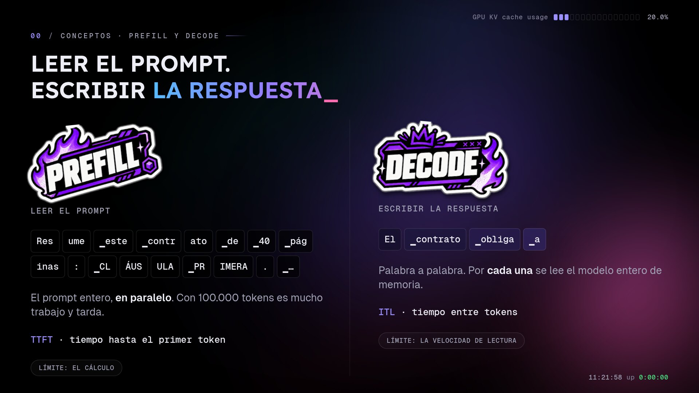
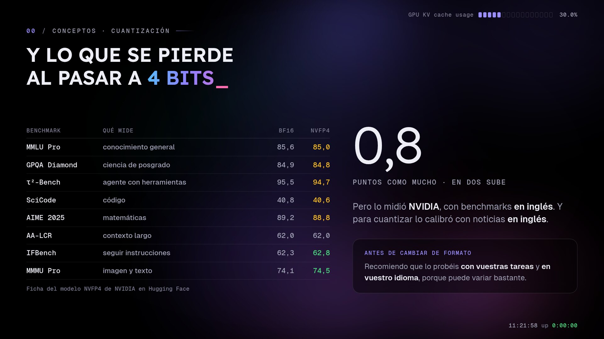
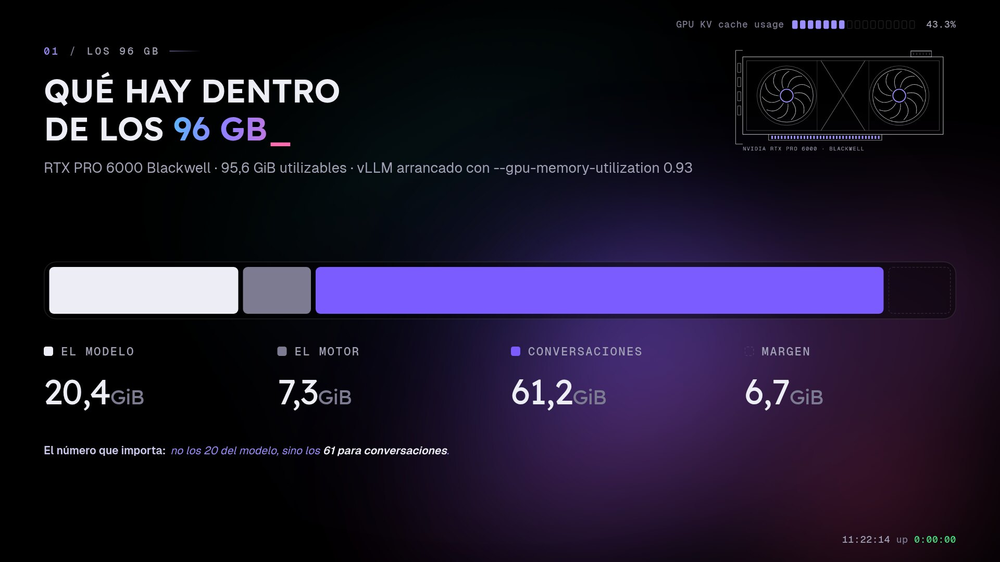
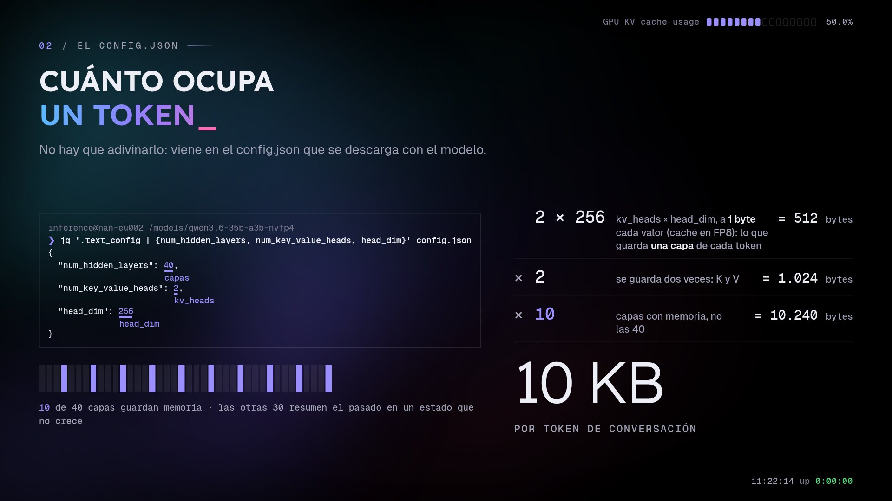
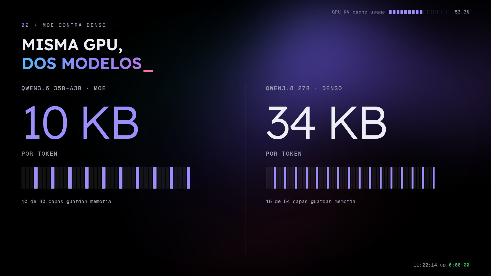
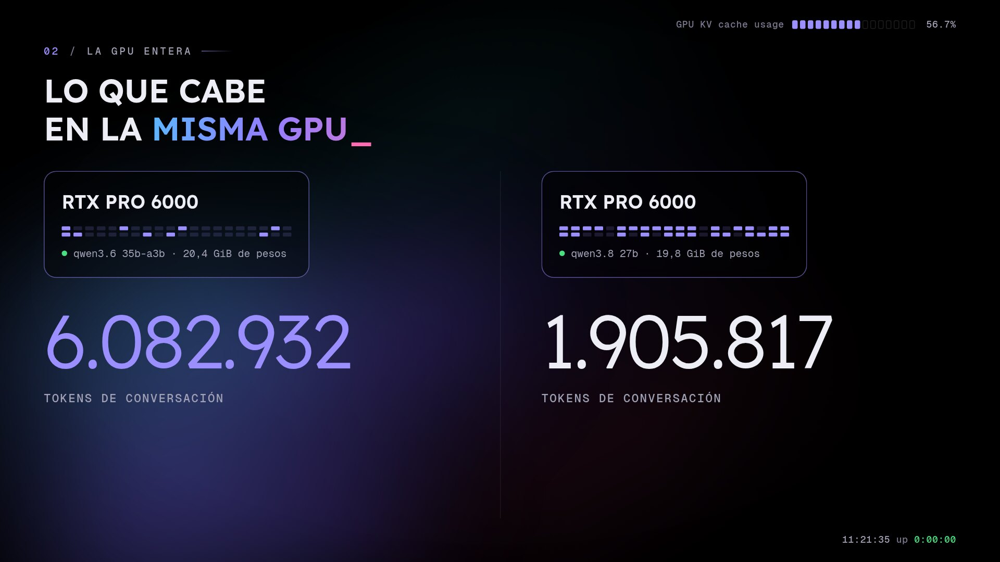
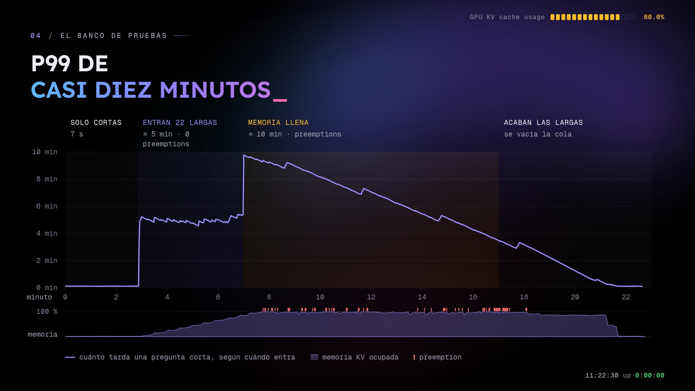
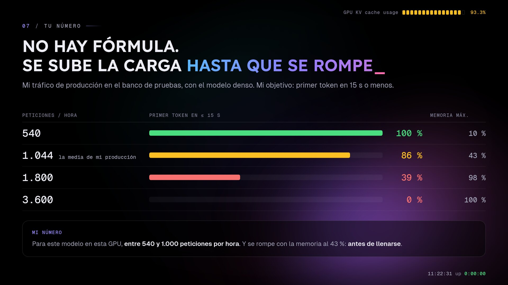

El sábado di una charla en el **AWS Community Day Spain 2026**, en Santiago de Compostela: *Dimensionar por tokens, no por gigas*. Va de una pregunta que parece de principiante y no lo es: cuántos usuarios aguanta una GPU sirviendo un modelo de lenguaje.

La respuesta habitual es mirar los gigas del modelo y compararlos con los de la tarjeta. Esa cuenta te dice si el modelo arranca, pero no para cuánta gente. Este post es la versión escrita, con las slides de la charla y algo más de detalle del que cabe en treinta minutos. Las slides completas están en [talks.crstian.me](https://talks.crstian.me/aws-community-day/).

Todo lo que cuento sale de las máquinas de [Helmcode](https://helmcode.com), de producción o de un banco de pruebas con la misma GPU y la misma configuración, y digo cada vez de cuál. El modelo es **Qwen3.6-35B-A3B en NVFP4, servido con vLLM en una RTX PRO 6000 Blackwell de 96 GB**. Como contraste uso un modelo de la misma familia, Qwen3.8-27B, que es denso.

## Resumen rápido

La receta son cinco pasos. Los tres primeros se calculan y los dos últimos se miden:

1. **Pesos**: parámetros × bytes por parámetro. Sale del nombre del modelo.
2. **Memoria por token**: sale del `config.json`, mirando cuántas capas guardan memoria.
3. **Tokens que caben**: lo que sobra de la GPU entre la memoria por token. O la línea del log de vLLM.
4. **Usuarios**: tokens que caben entre tokens por usuario. Este dato no está en ningún archivo, lo medís vosotros.
5. **Tokens por segundo**: cargad la GPU con vuestras conversaciones más largas y mirad el primer token.

Hay dos límites y los dos se miden en tokens: cuántos caben (memoria) y cuántos da tiempo a procesar (cálculo).

## Cinco conceptos antes de empezar

### Todo se cuenta en tokens


Un modelo no ve palabras, ve tokens: trozos de texto. Con el tokenizador de Qwen3.6, "¿Cuántos usuarios aguanta mi GPU?" son cinco palabras y diez tokens. La misma pregunta en inglés son siete palabras y ocho tokens. Los tokenizadores se entrenan sobre todo con texto en inglés, así que en español pagamos más tokens por lo mismo.

Lo que le mandas es el prompt y lo que te devuelve es la respuesta, y las dos cosas cuestan tokens. El contexto son todos los tokens de una conversación: el *system prompt*, el historial y lo que ya ha generado. Cada modelo tiene un máximo en su `config.json`. El mío admite 262.144.

### Cómo leer el nombre de un modelo


Un modelo es un montón de números, los pesos, que se cargan enteros en la GPU al arrancar y no cambian. El nombre trae tres datos para dimensionar:

- **35B**: unos 35.000 millones de parámetros. Es lo que ocupa.
- **A3B**: 3.000 millones activos por token. Es un MoE (*mixture of experts*): cada capa tiene 256 expertos y un router elige 8 para cada token. Ocupa como uno grande y calcula casi como uno pequeño, pero los 35.000 millones tienen que estar cargados siempre, porque no sabes qué experto pedirá el siguiente token.
- **NVFP4**: el formato de 4 bits de NVIDIA, medio byte por parámetro.

35.000 millones por medio byte son unos 18 GB. En la práctica son 20,4 GiB, porque no todo va en 4 bits: la atención va en FP8, los embeddings y el encoder de visión se quedan en 16 bits, y cada bloque de 16 pesos guarda su escala.

El rival, **Qwen3.8-27B-NVFP4**, no lleva A: es denso, y en cada token trabajan sus 27.000 millones.

### Prefill y decode



Una petición tiene dos fases que se comportan de forma muy distinta:

- **Prefill**: leer el prompt entero, de golpe y en paralelo. Con cien mil tokens es mucho cálculo y tarda. Se ve en el **TTFT** (*time to first token*), que es la cola más el prefill.
- **Decode**: escribir la respuesta palabra a palabra. Por cada token nuevo, la GPU se lee el modelo entero de memoria, así que lo que limita es la velocidad de lectura, más que el cálculo. Se ve en el **ITL** (*inter-token latency*), el tiempo entre un token y el siguiente.

### La KV-caché

Para generar cada token, el modelo vuelve a mirar toda la conversación anterior. Recalcularla cada vez sería lentísimo, así que guarda dos vectores por cada token ya visto, K (*key*) y V (*value*). Ese almacén es la **KV-caché**, y es el concepto más importante de este post.

Los pesos se cargan una vez y son fijos. La KV-caché crece con cada token que escribe el usuario y con cada token que responde el modelo. Cada conversación ocupa su sitio y esa memoria no se libera hasta que la petición termina.

### Cuantizar: qué se gana y qué se pierde

En 16 bits, mi modelo de 35B ocuparía unos 65 GiB. En NVFP4 se queda en 20,4.

La KV-caché se cuantiza aparte, y para dimensionar es la decisión que más pesa. En 16 bits cada token ocuparía 20 KB; con `--kv-cache-dtype fp8` ocupa 10 KB. En la misma memoria caben 6 millones de tokens en vez de 3. Además va más rápido, porque en el decode hay menos bytes que leer en cada paso. Eso sí, cuantizar la KV-caché puede dar bastantes problemas de calidad, sobre todo en conversaciones largas. Medidlo antes de cambiar.



¿Y cuánto se pierde con los pesos en 4 bits? Esta es la tabla que publica NVIDIA en la [ficha del modelo](https://huggingface.co/nvidia/Qwen3.6-35B-A3B-NVFP4): ocho benchmarks, en BF16 y en NVFP4. Lo máximo que pierde son 0,8 puntos, en contexto largo nada, y en dos sube (ruido de la medida).

Pero lo midió NVIDIA, con benchmarks en inglés, y para cuantizar calibró con noticias de la CNN, también en inglés. El número del benchmark no es el vuestro. Probadlo con vuestras tareas y en vuestro idioma antes de cambiar de formato, porque puede variar bastante.

### Batching: leer el modelo para uno o para 128 cuesta lo mismo


En cada paso de decode la GPU se lee el modelo una vez, da igual para cuántas conversaciones, y saca un token para cada una. Lo medí en el banco con el denso de 27B, con prompts de 2.000 tokens y respuestas de 500:

| Conversaciones a la vez | Tokens/s por usuario | Tokens/s en total |
|---|---|---|
| 1 | 64 | 64 |
| 8 | ~60 | ~470 |
| 128 | 12 | ~1.570 |

Con ocho a la vez el paso apenas crece: es trabajo casi gratis. Con 128, la KV-caché y las cuentas de cada conversación ya pesan más que leer el modelo, el paso pasa de 16 a 81 ms y a cada persona le llegan 12 tokens por segundo.

Ese máximo lo pone el operador con `--max-num-seqs`. Yo lo tengo en 128, y es una decisión de producto: más gente, o más rápido para cada uno.

### Si venís de infra, ya sabéis servir esto


| Inferencia | Lo que ya conocéis |
|---|---|
| vLLM | un gunicorn especializado: API de OpenAI en `:8000`, `/metrics` y `/health` |
| LiteLLM | el API gateway de delante: keys, equipos y presupuestos |
| `max-num-seqs` | el `maxConnections`: cuántas conversaciones a la vez |
| KV-caché | la sesión de cada conexión en RAM, que crece con cada mensaje |
| preemption | un *eviction*: se echa una conversación para hacer sitio y vuelve a la cola |
| TTFT · ITL | vuestra latencia: la primera palabra y el hueco entre palabras |

## Qué hay dentro de una GPU de 96 GB



La RTX PRO 6000 Blackwell tiene 95,6 GiB utilizables, y con `--gpu-memory-utilization 0.93` vLLM se queda con el 93 % al arrancar, haya tráfico o no:

| Parte | GiB |
|---|---|
| El modelo | 20,4 |
| El motor (buffers y trabajo intermedio) | 7,3 |
| **Conversaciones (KV-caché)** | **61,2** |
| Margen que vLLM no toca | 6,7 |

El número que importa son los 61 GiB para conversaciones, no los 20 del modelo.

### El 95 % de nvidia-smi no dice nada

```
93734MiB / 97887MiB      0%
```

Este `nvidia-smi` es de una máquina de producción: memoria al 95 % y uso al 0 %, sin una sola petición en ese momento. Como vLLM reserva toda la memoria al arrancar, ese 95 % está ahí desde el primer segundo. No os va a decir nunca nada sobre la carga.

## Cuánto ocupa un token: el config.json



No hay que adivinarlo, viene en el `config.json` que se descarga con el modelo. En este Qwen los campos están dentro de `text_config` porque es multimodal:

```bash
jq '.text_config | {num_hidden_layers, num_key_value_heads, head_dim}' config.json
```

```json
{ "num_hidden_layers": 40, "num_key_value_heads": 2, "head_dim": 256 }
```

La cuenta, factor a factor:

- Cada capa guarda `num_key_value_heads × head_dim` valores por token: 2 × 256 = 512. Con la caché en FP8, cada valor es un byte: **512 bytes**.
- Se guarda dos veces, una para K y otra para V: **1.024 bytes**.
- Y aquí está el truco: de las 40 capas, solo 10 guardan memoria. El campo `layer_types` marca 10 como `full_attention` y 30 como `linear_attention`, que resumen el pasado en un estado de tamaño fijo que no crece. Así que se multiplica por 10, no por 40: **10.240 bytes, unos 10 KB por token**.

Si dividís la memoria de caché que reporta vLLM entre los tokens que dice que caben, salen 10,8 KB. La diferencia es el estado de las capas lineales.

### MoE contra denso: el pequeño ocupa tres veces más



El Qwen3.8 de 27B es más pequeño en disco, pero tiene 64 capas, guardan memoria 16, y cada una con el doble de cabezas KV. Sale a **34 KB por token**, tres veces más que el de 35B.



En la GPU entera, con casi los mismos gigas de pesos (20,4 frente a 19,8), caben **6.082.932 tokens** de conversación con el MoE y **1.905.817** con el denso. El modelo cabía en las dos; lo que cambia es para cuánta gente. Por eso, cuando sale un modelo nuevo, lo primero es abrir su `config.json` y mirar `num_key_value_heads` y `layer_types`.

### vLLM ya hace la cuenta por vosotros

No hace falta calcularlo a mano. vLLM lo escribe en el log al arrancar, y estas tres líneas son de mi producción:

```
INFO [gpu_worker.py:538]      Available KV cache memory: 61.24 GiB
INFO [kv_cache_utils.py:2146] GPU KV cache size: 6,082,932 tokens
INFO [kv_cache_utils.py:2147] Maximum concurrency for 262,144 tokens per request: 23.20x
```

Memoria para conversaciones, tokens que caben y cuántas peticiones de contexto máximo caben a la vez. Están en vuestros logs y casi nadie las lee.

## ¿Cuántos usuarios entran?

La cuenta es una división: 6.082.932 tokens entre los tokens que trae cada usuario.

| Cada usuario trae | Por memoria | Caben a la vez |
|---|---|---|
| un chat, 2.500 tokens | 2.433 | **128**, el tope de `max-num-seqs` |
| un documento, 100.000 tokens | 60,8 | **60** |
| el contexto máximo, 262.144 tokens | 23,2 | **23**, el `23.20x` del log |

Con chats no manda la memoria, manda el tope que pongo yo: hasta unos 47.500 tokens por usuario (6.082.932 ÷ 128) salen 128. A partir de ahí manda la memoria. Así que la respuesta va de 128 a 23, y depende de un número que no está en ningún archivo de configuración.

Esto es a la vez: cuántas conversaciones caben juntas en la KV-caché, no cuántos usuarios tiene el producto al día.

### No hay un usuario medio


Esta es mi producción durante una semana: qué porcentaje de peticiones trae hasta tantos tokens de prompt. Tiene dos jorobas. A la izquierda, los chats: el 48,9 % de las peticiones está por debajo de 2.000 tokens. A la derecha, los agentes: el 23,4 % pasa de 50.000, porque reenvían todo el historial en cada turno. (En total, el 81 % de los tokens de entrada se reaprovecha con *prefix caching*, así que los agentes no recalculan todo en cada turno.)

Las tres filas de la tabla de antes existen en mi tráfico a la vez. Si dimensionáis con la media, os equivocáis con las dos poblaciones.

## Qué pasa cuando no cabe uno más: preemption


Cuando la KV-caché se llena, vLLM no devuelve un error. Hace esto:

1. Elige una conversación en curso y le quita su memoria para dársela a las demás.
2. Esa petición vuelve a la cola, y se cuela la primera.
3. Cuando hay sitio, vuelve a entrar. Pero su memoria ya no existe, así que se recalcula toda su conversación desde cero.

Eso es una **preemption**. Para ese usuario la petición no falla: ni un 500, el pod está `Ready` y `/health` responde 200. Se queda parada en silencio mientras se recalcula y luego sigue.

**No falla, se ralentiza.** Y es peor que un error, porque no salta ninguna alerta.

### Así se ve en el banco de pruebas



Qwen3.8 de 27B en el banco, con la misma GPU y la misma configuración que producción. La línea es cuánto tarda una pregunta corta según el minuto en que entra, y abajo está la memoria KV ocupada.

- Al principio solo hay preguntas cortas: **7 segundos**.
- Desde el minuto 3 entran 22 conversaciones de 100.000 tokens. La pregunta corta pasa a **5 minutos**, con la memoria a medias y **cero preemptions**.
- Desde el minuto 7 se llena la memoria y llegan las preemptions (las rayas rojas). Casi **10 minutos**, con un p99 de **577 segundos**.
- Cuando acaban las largas, la cola se vacía y vuelve a 7 segundos.

928 peticiones y cero errores. Nada falla, solo tarda.

Y fijaos en el segundo tramo: la pregunta corta ya tardaba cinco minutos con la memoria a medias y sin ninguna preemption. Algo se había acabado antes que la memoria.

## Dos límites: memoria y cálculo


Lo que se acabó fue el tiempo de la GPU. Cada conversación larga hay que leerla entera (el prefill) antes de contestar, y mientras tanto la pregunta corta espera en la cola. Hay dos límites, y los dos se miden en tokens:

1. **Memoria**: cuántos tokens caben. Se calcula, con el `config.json` o el log de vLLM.
2. **Cálculo**: cuántos tokens da tiempo a procesar. No se calcula, se mide con vuestras conversaciones más largas.

Para ver lo que pesa el cálculo, este es el tiempo hasta la primera palabra de una sola petición, sola en la GPU, sin cola ni nadie más:

| Prompt | Denso 27B | MoE, 3B activos |
|---|---|---|
| 16k tokens | 1,8 s | 0,7 s |
| 64k tokens | 10,8 s | 3,8 s |
| 128k tokens | 31,8 s | 11,4 s |
| 250k tokens | **97,7 s** | **38,1 s** |

Casi cien segundos solo en leer el prompt.

### Al denso le sobra memoria y le falta cálculo


Reproduje el tráfico real de producción en el banco con los dos modelos, misma GPU y mismos flags. Primer token, p99:

- **Denso**: **88 segundos**, con la memoria al 43 % y cero preemptions. Se le acaba el cálculo mucho antes que la memoria.
- **MoE**: **23 segundos**, con la memoria al 8 %.

Con agentes se ve todavía más. Con 24 sesiones reales de agentes de programación a la vez, al denso le llegan **3 tokens por segundo** a cada usuario, que es inservible. Al MoE, **30**. El MoE gana dos veces: menos memoria por token (10 KB frente a 34) y menos cálculo por token (3.000 millones de parámetros activos frente a 27.000).

## Qué vigilar en producción: una métrica por límite

Para la **memoria**, `vllm:num_preemptions_total`: cuántas veces el motor ha echado a alguien. En mi producción lleva cero en treinta días, y el pico de memoria de la semana en que lo medí fue del 23 %. Con 10 KB por token me sobra muchísima.

Para el **cálculo**, `vllm:inter_token_latency_seconds`: el hueco entre una palabra y la siguiente. Cuando va bien son unos 6 ms. En el banco, con doce agentes a la vez, a uno le llegaron 18 segundos sin una sola palabra, y sin ninguna preemption.

Vigilad el hueco y no la latencia total de la petición. Una petición puede tardar minutos y estar perfecta si le habéis pedido mucho texto. Lo que delata el problema es que deje de salir texto. Si os salta un pico, cruzadlo con el log de vLLM, que en la línea de estadísticas añade un campo `Preemptions:` en cuanto deja de ser cero. Cómo saltar de una métrica a sus logs en Grafana lo conté en [correlación de métricas y logs con Grafana y Loki](/post/2024-05-02-correlacion-metricas/).

Y la alerta, que se pone en cinco minutos:

```yaml
groups:
  - name: vllm
    rules:
      - alert: VLLMPreemptions
        expr: increase(vllm:num_preemptions_total[5m]) > 0
        labels:
          severity: warning
        annotations:
          summary: "vLLM está echando conversaciones por falta de KV-caché"
```

## No hay fórmula: se sube la carga hasta que se rompe



A lo mejor parece que os he hecho un poco de *bait*: tanta cuenta y ahora resulta que no hay fórmula. La memoria sí se calcula, y la cuenta de antes vale. Lo que no tiene fórmula es el cálculo, porque depende de vuestro tráfico: de lo largos que sean los prompts y de cuántos llegan a la vez. Por eso el número de verdad sale de una prueba de carga.

Se coge vuestro tráfico y se sube la carga hasta que se rompe vuestro objetivo. El mío es que la primera palabra llegue en 15 segundos o menos (es mi objetivo, no un estándar). Con el tráfico real de producción en el banco, y el denso:

| Peticiones/hora | Primer token en ≤ 15 s | Memoria máxima |
|---|---|---|
| 540 | 100 % | 10 % |
| 1.044 (la media de mi producción) | 86 % | 43 % |
| 1.800 | 39 % | 98 % |
| 3.600 | 0 % | 100 %, con preemptions |

Mi número, para este modelo en esta GPU, está entre 540 y 1.000 peticiones por hora. Y se rompe con la memoria a menos de la mitad: otra vez el cálculo.

## La receta en cinco pasos


No es exacta, pero acerca mucho:

1. **Pesos**: parámetros × bytes por parámetro, del nombre del modelo.
2. **Memoria por token**: del `config.json`, mirando qué capas guardan memoria.
3. **Tokens que caben**: lo que sobra de la GPU entre la memoria por token, o la línea `GPU KV cache size` del log de vLLM.
4. **Usuarios**: tokens que caben entre tokens por usuario. Medid cuántos trae cada uno, y no os quedéis con la media.
5. **Tokens por segundo**: cargad la GPU con vuestras conversaciones más largas (con [AIPerf](https://github.com/ai-dynamo/aiperf) de NVIDIA, o con vuestro tráfico real) y mirad el primer token. Si se dispara antes de que se llene la memoria, vuestro límite es el cálculo.

## Preguntas frecuentes

### ¿Cuánta VRAM necesito para servir un LLM?

La de los pesos (parámetros × bytes por parámetro), más la KV-caché que necesiten vuestros usuarios, más unos 7 GB para el motor. En una GPU de 96 GB con un modelo de 35B en 4 bits, los pesos son 20 GiB y la KV-caché 61.

### ¿Cómo calculo cuántos usuarios aguanta una GPU?

Dividid los tokens que da vLLM en el log de arranque (`GPU KV cache size`) entre los tokens por petición, prompt más respuesta. Quedaos con el menor entre ese resultado y `max-num-seqs`. Eso es el límite de memoria; el de cálculo hay que medirlo con una prueba de carga.

### ¿Qué es la KV-caché de un LLM?

Los vectores K y V de cada token ya procesado, que el modelo guarda para no recalcular toda la conversación en cada paso. Crece con cada token de cada usuario y no se libera hasta que termina la petición.

### ¿Qué es una preemption en vLLM?

Cuando se llena la KV-caché, vLLM saca una petición en curso, libera su memoria y la devuelve a la cola. Al volver, recalcula toda su conversación desde cero. El usuario no ve un error, ve una pausa que puede ser de minutos.

### ¿Es mejor un modelo MoE o uno denso para servir a muchos usuarios?

En mis pruebas, el MoE: Qwen3.6-35B-A3B ocupa 10 KB por token frente a los 34 KB de Qwen3.8-27B, y como solo trabajan 3.000 millones de parámetros por token, también necesita mucho menos cálculo. Con tráfico real dio un primer token p99 de 23 s frente a 88 s.

---

Las slides y el material de la charla están en [crstian.me/talks](https://crstian.me/talks). Si queréis ver esto funcionando con mucha gente encima, pasaos por [NaN](https://nan.builders), la comunidad que comparte estas GPUs. Y si tenéis un p99 raro esta semana, escribidme.
