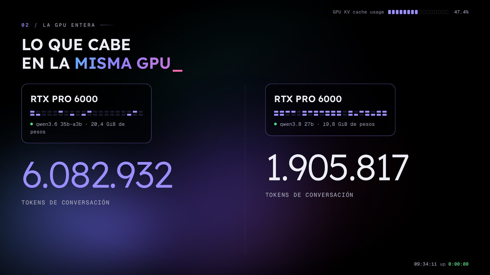
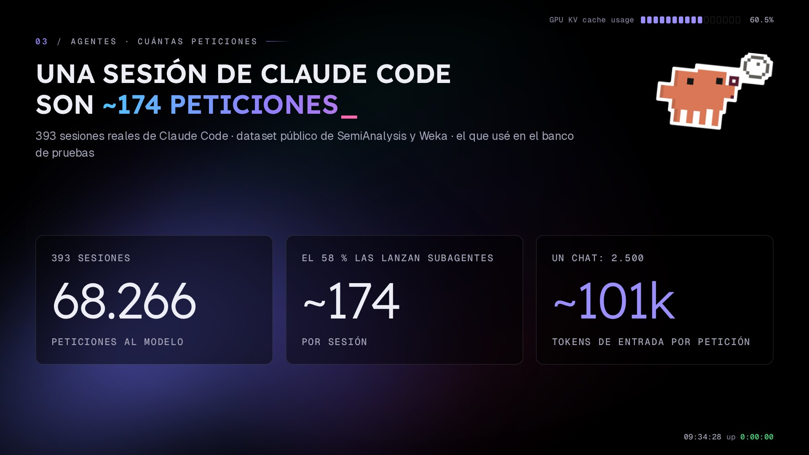
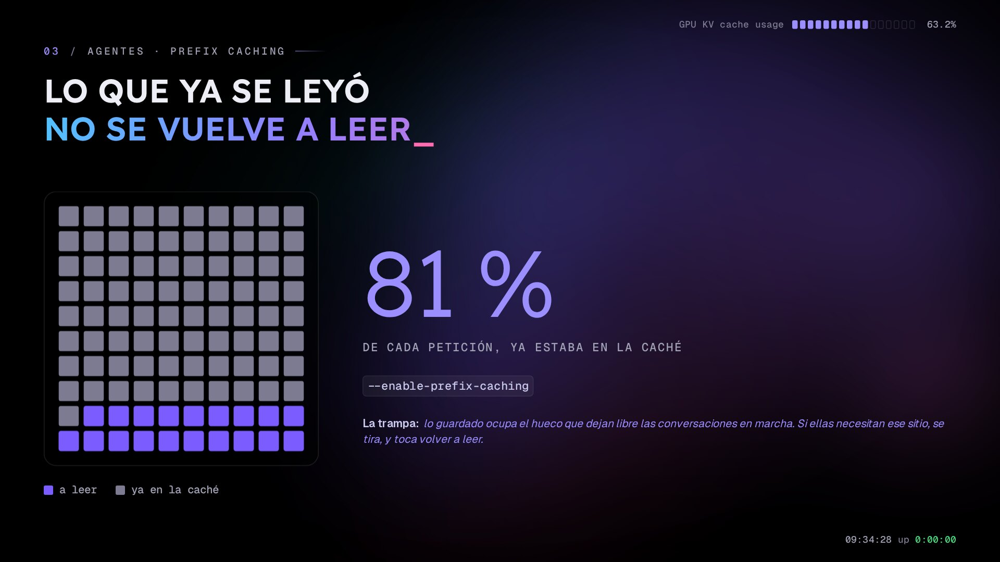
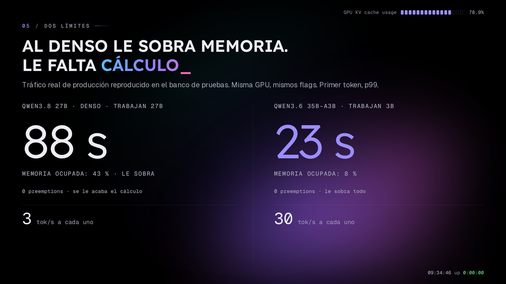
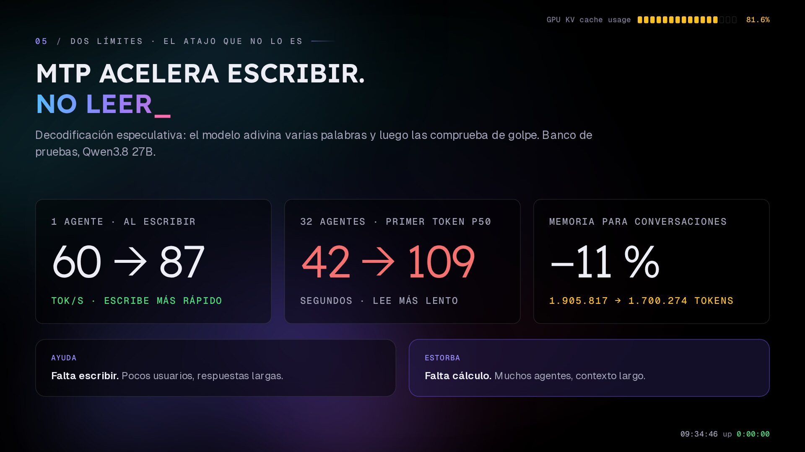
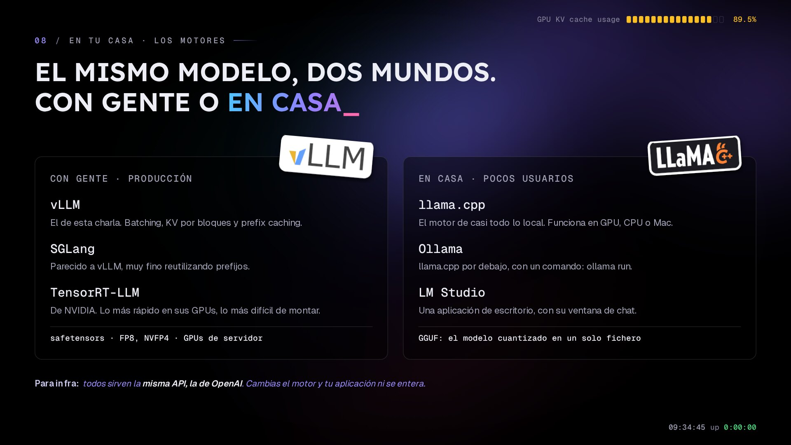
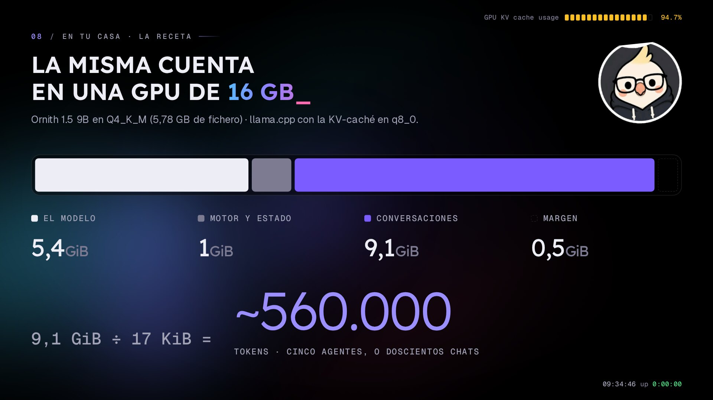

import video from './assets/peticion-de-principio-a-fin.mp4?url'
import poster from './assets/peticion-de-principio-a-fin-poster.jpg'

El jueves estuve dando la charla *Gigas vs tokens: desplegando un LLM en tu propia infra* en la **[Murcia Tech Talk](https://murciatech.org)**, en el CEEIM del Campus de Espinardo. Es la misma que llevé al AWS Community Day pero con dos partes nuevas, una sobre qué pasa cuando los que usan la GPU no son personas sino agentes, y otra sobre cómo hacer la misma cuenta con una gráfica de casa.

Lo básico (qué es la KV-caché, qué hay dentro de una GPU de 96 GB, por qué hay dos límites y qué es una preemption) ya lo conté en [¿Cuántos usuarios aguanta tu GPU? Dimensionar un LLM por tokens](/post/2026-10-19-dimensionar-gpu-llm-por-tokens/), así que aquí lo resumo rápido y me centro en lo nuevo. Las slides las tenéis en [crstian.me/talks](https://crstian.me/talks).

Todos los números salen de las máquinas de [Helmcode](https://helmcode.com), o de producción o de un banco de pruebas con la misma GPU (una RTX PRO 6000 Blackwell de 96 GB), y en cada caso digo de cuál.

## Lo importante

- Un agente no es un chat. Una sesión de Claude Code son unas 174 peticiones al modelo y cada una llega con unos 100.000 tokens, cuarenta veces un chat.
- Lo que hace que los agentes sean viables es el prefix caching. En mi producción el 81 % de lo que entra ya estaba en la caché, el problema es que esa caché es lo primero que se tira cuando falta memoria.
- Con agentes lo que se acaba antes suele ser el cálculo, no la memoria. El modelo denso tarda 88 s en empezar a contestar con la memoria al 43 %.
- MTP acelera escribir, no leer. Con un agente va más rápido, con 32 el primer token tarda más del doble.
- Para casa, llama.cpp y GGUF en 4 bits. En una gráfica de 16 GB caben unos 560.000 tokens con el modelo adecuado, que son cinco agentes o doscientos chats.

## Lo básico, rápido

Que el modelo quepa en la GPU no te dice para cuánta gente sirve. Lo que llena la tarjeta en producción es la **KV-caché**, que es lo que el modelo guarda de cada token de cada conversación para no tener que recalcularlo. Los pesos se cargan una vez, la KV-caché va creciendo con cada token.

Cuánto ocupa un token lo sacas del `config.json`. Con el modelo que uso, Qwen3.6-35B-A3B en NVFP4, son unos 10 KB porque solo 10 de sus 40 capas guardan memoria. Su primo denso, Qwen3.8-27B, siendo más pequeño ocupa 34 KB por token.



En la misma GPU eso son 6,08 millones de tokens de conversación con uno y 1,9 millones con el otro. Y hay dos límites, los dos en tokens: cuántos caben, que es memoria y se calcula, y cuántos da tiempo a procesar, que es cálculo y hay que medirlo.

## Una petición de principio a fin

Esta slide es nueva y es la que más me gusta, porque junta todos los conceptos siguiendo el viaje de una sola petición:

<video
  src={video}
  poster={poster.src}
  autoplay
  muted
  loop
  playsinline
  preload="metadata"
  class="w-full rounded-xl border border-border"
  aria-label="Animación de una petición: llega a la cola de vLLM, reutiliza la caché de prefijos, hace el prefill, el decode y deja su KV-caché como caché"
></video>

1. El agente manda la conversación entera, el historial más lo nuevo. Eso es el prompt.
2. La petición espera en la cola. vLLM corre en la CPU del servidor, recibe la petición y la deja en la RAM hasta que haya sitio en la GPU, o sea, que no estén ocupadas las 128 plazas y que quede memoria.
3. Si el principio de la petición ya pasó por la GPU hace poco y su KV-caché sigue en memoria, esa parte no se vuelve a calcular.
4. En el prefill se lee todo lo nuevo de golpe. Los núcleos de la GPU traen los pesos de la memoria, hacen las cuentas de todos los tokens nuevos a la vez y guardan su KV-caché. Cuando sale la primera palabra, eso es el TTFT.
5. En el decode sale una palabra por paso. En cada paso los núcleos traen los pesos una sola vez para todas las conversaciones, más la KV-caché de cada una, y sacan una palabra para cada una. El ritmo al que salen es el ITL.
6. Cuando acaba, su KV-caché se queda como caché por si la siguiente petición empieza igual, hasta que otra conversación necesite el sitio.

## Un agente no es un chat


Un agente es un modelo dentro de un bucle. El modelo decide qué hacer y el programa que tiene alrededor, el *harness* (Claude Code, OpenCode, el que sea), lo ejecuta con sus herramientas y le devuelve el resultado.

Si le pides que arregle el CSS de una portada, eso son varias peticiones seguidas, una para leer el fichero, otra para editarlo y otra para comprobar el build. La cosa es que cada una lleva delante todo lo anterior: las instrucciones, el fichero entero y lo que el modelo ha ido pensando. Para el servidor, una tarea de una frase son decenas de peticiones con toda la conversación delante.

### Cuántas peticiones son



Esto no me lo invento, hay un dataset público con sesiones reales de Claude Code que publicaron SemiAnalysis y Weka, y es el que usé en el banco de pruebas.

| | |
|---|---|
| Sesiones | 393 |
| Peticiones al modelo | 68.266 |
| Peticiones por sesión | ~174 |
| Lanzadas por subagentes | 58 % |
| Tokens de entrada por petición (media) | ~101.000 |

Un chat normal trae unos 2.500 tokens y una petición de un agente, cuarenta veces más. Así que antes de preguntarte cuántos usuarios te entran en una GPU, tienes que saber si son personas o agentes. En mi producción hay de las dos cosas, la mitad de las peticiones traen menos de 2.000 tokens y casi una de cada cuatro pasa de 50.000.

### Lo que ya se leyó no se vuelve a leer



Lo que salva a los agentes es que cada petición se parece muchísimo a la anterior, todo lo de antes más un trozo nuevo. vLLM lo aprovecha con el **prefix caching** (`--enable-prefix-caching`): si el principio de la petición ya lo procesó hace poco, reutiliza esa KV-caché y solo hace el prefill de lo nuevo.

En mi producción, en una semana, el 81 % de lo que entra ya estaba en la caché. Solo hay que leer una de cada cinco partes.

El problema es dónde vive esa caché. Vive en el hueco de la KV-caché que dejan libre las conversaciones que están en marcha, así que cuando ellas necesitan sitio lo guardado es lo primero que se tira. Y en ese momento cada vuelta del agente vuelve a leer sus cien mil tokens enteros, que es justo el trabajo que más cálculo cuesta.

## Con agentes se acaba antes el cálculo

En el post anterior conté cómo una pregunta corta pasaba de 7 segundos a casi 10 minutos en el banco de pruebas, y que el primer tramo de esa subida pasaba con la memoria a medias y sin ninguna preemption. Lo que se acababa era el tiempo de GPU, porque cada conversación larga hay que leerla entera antes de contestar.



Reproduciendo en el banco el tráfico real de producción, con la misma GPU y los mismos flags, el primer token (p99) queda así:

- Denso, Qwen3.8 27B: 88 segundos, con la memoria al 43 % y cero preemptions.
- MoE, Qwen3.6 35B-A3B: 23 segundos, con la memoria al 8 %.

Y con 24 sesiones reales de agentes de programación a la vez, al denso le llegan 3 tokens por segundo a cada usuario, que es inservible, y al MoE 30. En cada token del MoE solo trabajan 3.000 millones de parámetros, así que gana por los dos lados: menos memoria por token y menos cálculo por token.

## MTP acelera escribir, no leer



En todas las charlas sale la misma pregunta, que qué pasa si activo MTP. MTP es decodificación especulativa, el modelo adivina varias palabras por delante y luego las comprueba todas de golpe, y los Qwen nuevos ya lo traen de serie. Lo medí en el banco con el denso de 27B:

| | Sin MTP | Con MTP |
|---|---|---|
| 1 agente, tokens/s escribiendo | 60 | 87 |
| 32 agentes, primer token (p50) | 42 s | 109 s |
| Tokens que caben en la KV-caché | 1.905.817 | 1.700.274 (−11 %) |

Con un agente acelera el decode. Con muchos, las adivinanzas gastan cálculo, que es justo lo que ya faltaba, y el primer token tarda más del doble. Además los pesos de MTP le quitan un 11 % de sitio a las conversaciones.

Así que MTP ayuda cuando os falta velocidad para escribir (pocos usuarios y respuestas largas) y estorba cuando os falta cálculo (muchos agentes y contexto largo). En el MoE, con uno o dos usuarios, incluso frena, escribía tan rápido que pasó de 220 a 162 tokens por segundo. En producción no lo tengo activado porque mi caso es el de muchos agentes, y además allí me rompía las llamadas a herramientas.

## En tu casa

Esta es la otra parte nueva de la charla, la misma cuenta pero con una gráfica normal.

### Los motores: con gente o en casa



| Con gente, en producción | En casa |
|---|---|
| **vLLM**: el de esta charla. Batching, KV-caché por bloques y prefix caching | **llama.cpp**: el motor de casi todo lo local. Funciona en una gráfica de jugar, en CPU o en un Mac |
| **SGLang**: muy parecido, muy fino reutilizando prefijos | **Ollama**: llama.cpp por debajo, con un comando |
| **TensorRT-LLM**: el de NVIDIA, el más rápido en sus tarjetas y el más difícil de montar | **LM Studio**: una aplicación de escritorio con su ventana de chat |
| Formato de Hugging Face (safetensors), cuantizado para la GPU: FP8, NVFP4 | **GGUF**: el modelo cuantizado y empaquetado en un solo fichero |

Para los que venimos de infra lo mejor es que todos sirven la misma API, la de OpenAI, así que cambias de motor y tu aplicación ni se entera.

### Cuánto se pierde en GGUF


Unsloth midió los GGUF del denso de 27B. Cada punto es un fichero, cuanto más a la derecha más grande y cuanto más arriba más se parece al original. Lo que mide es cuántas veces elige la misma siguiente palabra que el modelo en 16 bits, no cuántas tareas resuelve.

| Cuantización | Tamaño | Igual que BF16 |
|---|---|---|
| Q8 (~8 bits) | 27,7 GB | 98,7 % |
| Q4_K_M (~4 bits) | 16,1 GB | 95,8 % |
| IQ2_XXS (~2 bits) | 7,3 GB | 79,1 % |

De 8 a 4 bits se pierden tres puntos por la mitad de memoria, que es casi gratis. De 4 a 2 se pierden veinte. La curva no baja en línea recta, por debajo de unos 3 bits se desploma, así que para casa yo me quedaría con 4 bits. Ojo, que esta gráfica es de un empaquetador y no una prueba independiente.

### La misma cuenta en una GPU de 16 GB



Para casa no cojo el de 27B, cojo uno pequeño y muy descargado, **Ornith 1.5 9B en Q4_K_M**, y sigo la misma receta:

1. Los pesos son 5,78 GB de fichero, unos 5,4 GiB en la tarjeta.
2. El motor y su estado se llevan alrededor de 1 GiB, más medio de margen. Esto es una estimación, mirad vuestro log.
3. Para conversaciones quedan 9,1 GiB.
4. Para la memoria por token, su `config.json` dice 32 capas y solo 8 guardan memoria (`layer_types`), con 4 cabezas KV de 256. Con la caché en `q8_0` (32 valores en 34 bytes):

   ```
   2 × 8 × 4 × 256 × 34/32 = 17.408 bytes ≈ 17 KiB por token
   ```

   Es la mitad que el denso de 27B.
5. Tokens que caben: 9,1 GiB ÷ 17 KiB, unos **560.000 tokens**.

Eso da para cinco agentes de 100.000 tokens a la vez, o unos doscientos chats, en una gráfica de jugar. Creo que elegir bien el modelo vale más que la tarjeta.

### Con qué arrancarlo

En casa, llama.cpp. Estos flags son la cuenta de arriba: el fichero, medio millón de tokens repartidos en cinco conversaciones de cien mil, y la KV-caché en `q8_0`:

```bash
llama-server \
  -hf ornith-ai/Ornith-1.5-9B-GGUF:Q4_K_M \
  --ctx-size 500000 --parallel 5 \
  --cache-type-k q8_0 --cache-type-v q8_0
```

Con `--parallel`, llama.cpp reparte el contexto entre esas conversaciones. Hace batching continuo, pero no tiene la KV-caché por bloques ni el planificador de vLLM, está pensado para que te quepa, no para muchos usuarios.

Si hay gente detrás, vLLM. Estos son los flags que tengo en producción:

```bash
vllm serve /models/qwen3.6-35b-a3b-nvfp4 \
  --max-model-len 262144 \
  --max-num-seqs 128 \
  --kv-cache-dtype fp8 \
  --enable-prefix-caching
```

## La receta

Son cinco pasos, los tres primeros se calculan y los dos últimos se miden:

1. Pesos: parámetros por bytes por parámetro, que lo sacas del nombre del modelo.
2. Memoria por token: del `config.json`, mirando cuántas capas guardan memoria.
3. Tokens que caben: lo que sobra de la GPU entre la memoria por token, o directamente la línea `GPU KV cache size` del log de vLLM.
4. Usuarios: tokens que caben entre tokens por usuario. Y antes de eso, saber si son personas o agentes.
5. Tokens por segundo: cargad la GPU con vuestras conversaciones más largas (por ejemplo con [AIPerf](https://github.com/ai-dynamo/aiperf)) y mirad el primer token. Si se dispara antes de que se llene la memoria, vuestro límite es el cálculo.

## Preguntas frecuentes

### Cuántas peticiones hace un agente como Claude Code

En un dataset público de 393 sesiones reales de Claude Code salen de media unas 174 peticiones por sesión, con unos 101.000 tokens de entrada cada una. Más de la mitad las lanzan subagentes.

### Qué es el prefix caching de vLLM

Es reutilizar la KV-caché del principio de una petición cuando ya se procesó hace poco, para hacer el prefill solo de lo nuevo. Con agentes es lo que más ayuda, en mi producción el 81 % de los tokens de entrada ya estaba en la caché.

### Merece la pena activar MTP

Si tenéis pocos usuarios y respuestas largas, sí, porque acelera la escritura. Con muchos agentes y contexto largo no, gasta cálculo, retrasa el primer token y le quita memoria a las conversaciones.

### llama.cpp o vLLM

llama.cpp para correr un modelo en casa, en cualquier GPU, CPU o Mac, con pocos usuarios. vLLM para servir a mucha gente a la vez en GPUs de servidor. Los dos hablan la API de OpenAI.

### Qué cuantización GGUF elijo

Q4_K_M, que usa la mitad de memoria que 8 bits perdiendo muy poco. Por debajo de 3 bits la calidad cae en picado.

### Cuánta VRAM necesito para un LLM en local

La de los pesos, más la KV-caché de las conversaciones que queráis tener abiertas, más un poco para el motor. Con un modelo de 9B en Q4_K_M y 16 GB caben unos 560.000 tokens de conversación.

---

Si queréis ver esto funcionando con mucha gente encima, pasaos por [NaN](https://nan.builders). Y gracias a [Murcia Tech](https://murciatech.org) por invitarme.
