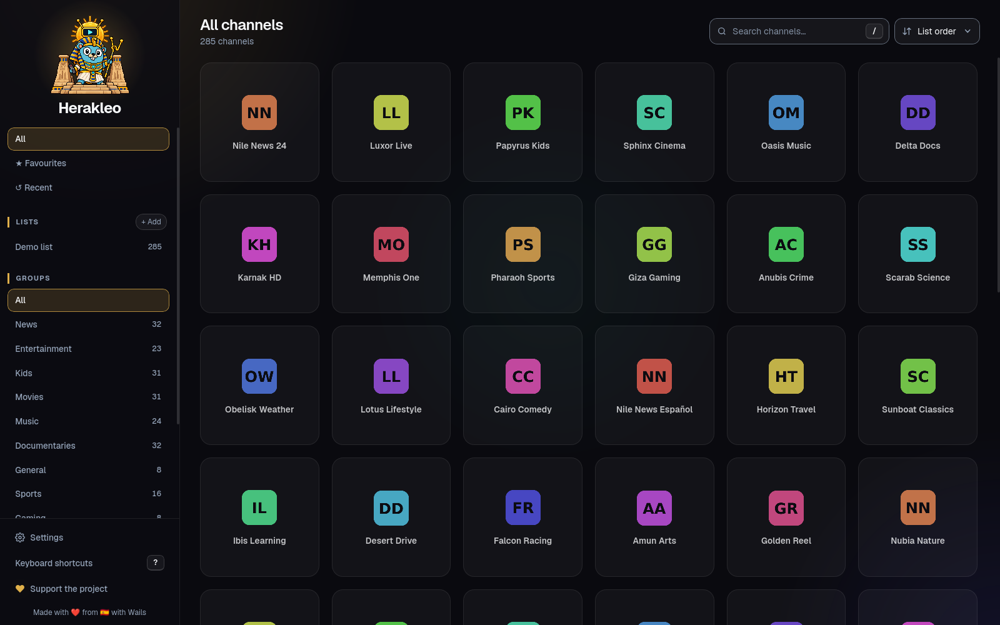
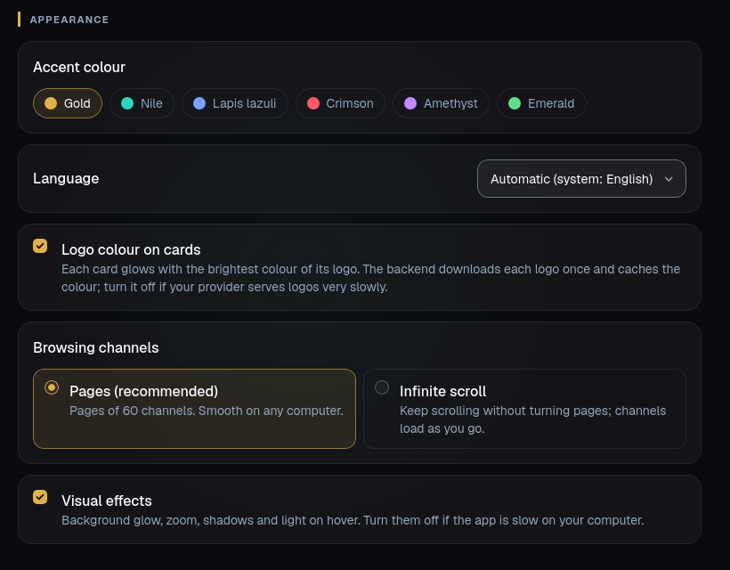

Quería hacer mi primera app de escritorio y dudaba entre dos frameworks, [Tauri 2](https://tauri.app/) (Rust) y [Wails](https://wails.io/) (Go). Los dos funcionan igual, un backend nativo y la interfaz web dentro del WebView del sistema, sin meter un Chromium entero como Electron. Como no me decidía, la hice con los dos.

La app es Herakleo, un reproductor IPTV para Linux, Windows y macOS (la comparación es solo en Linux). Le metes listas M3U o cuentas Xtream Codes, te enseña los canales en una cuadrícula y cada canal se abre en [mpv](https://mpv.io/). Las dos versiones compartían la misma interfaz en Svelte 5, así que lo único que cambiaba era el backend, y eso me dejó comparar Wails vs Tauri con una app de verdad y no con un hola mundo. La de Tauri ya no está en el repo, la borré después de la v0.1.0 y sigue en el historial de git.

Al final me he quedado con Wails, ya migrado a Wails v3 sobre GTK 4, y lo que más pesó no fue Go contra Rust sino el motor web que usan los dos en Linux, algo que no salía en ninguna comparativa teórica.



## Lo importante

- En el backend gana Rust, entre 2 y 4 veces más rápido que Go recorriendo texto, pero en la interfaz no se nota porque todo cae muy por debajo de un fotograma.
- En Linux Tauri 2 y Wails v2 usan el WebKitGTK de GTK 3, y ese port no pasa de 60 fps al hacer scroll aunque tengas un monitor de 120 Hz.
- Wails v3 usa el WebKitGTK de GTK 4 y hace scroll a 120 fps. Con Tauri hoy no hay forma de hacer eso en Linux.
- Recompilar tras cambiar una línea son 57 segundos en Tauri y 0,6 en Wails. Con un LLM escribiendo el código eso se nota más que cualquier diferencia del backend.
- Tauri gana en tamaño, memoria, ecosistema, móvil y seguridad por defecto. Si necesitara alguna de esas cosas, elegiría Tauri.

## Por qué la hice dos veces

Cada uno tenía sus razones. Wails tiraba porque sé Go. Tauri tiraba porque el código lo iba a escribir un LLM y no yo, así que saber Go pesaba menos, y además tiene más ecosistema (plugins, bundler, updater, móvil), más ejemplos por internet y hasta una app de referencia del mismo tipo, Fred TV (antes Open TV), hecha con Tauri. Sobre el papel ganaba Tauri, pero siendo mi primera app de escritorio no tenía experiencia para decidir solo leyendo, así que hice las dos y medí.

Como la interfaz es la misma, hacerla dos veces solo cuesta el backend, unas 2.400 líneas por lenguaje sin contar tests. Para que la comparación fuese justa, la frontera es un contrato en TypeScript (`frontend/src/lib/types.ts`) que implementan los dos backends, y cada uno tiene un adaptador de pocas líneas. Mismos tests, mismos ficheros en disco y un benchmark que se ejecuta dentro de las propias apps.

El vídeo no se reproduce en el WebView. WebKitGTK no decodifica MPEG-TS y mpv lo hace todo, así que cada canal se abre en un reproductor externo. Eso deja el vídeo fuera de la comparación y nos quedamos con lo que importa aquí, cargar listas enormes y moverse por ellas.

## La prueba: 65.081 canales de verdad

Todo está medido en mi equipo: CachyOS con Hyprland, Ryzen 7 5700X, Radeon RX 6800 y un monitor de 120 Hz. La biblioteca es real, una lista M3U con 65.081 canales que son 17 MB de caché en JSON.

```bash
just bench   # arranca las dos apps en release sobre una copia de la biblioteca y mide desde dentro del webview
```

Ojo, que esto es una sola máquina y mi lista. En otro equipo los números de memoria y arranque van a cambiar.

## Backend: Rust gana, y da igual

Midiendo solo el código de la biblioteca, sin interfaz (mediana):

| Operación | Go | Rust |
|---|---:|---:|
| Cargar la biblioteca (17 MB de JSON) | 52–62 ms | 27–32 ms |
| Primera página de canales | 1,1 ms | 0,3 ms |
| Búsqueda | 1,5 ms | 0,7 ms |
| Orden A→Z (una página) | 0,5 ms | 1,4 ms |

Rust es 2–4× más rápido recorriendo texto. En la interfaz no se nota nada, todo cae muy por debajo de un fotograma (16,7 ms a 60 Hz).

Lo más curioso de esta parte es que el LLM metió el mismo fallo en los dos lenguajes. La primera versión reordenaba los 65.000 canales en cada página del scroll infinito, 137 ms por página en Go y 31 ms en Rust, y la búsqueda pasaba todos los nombres a minúsculas en cada consulta. Con el orden A→Z en caché y la clave en minúsculas calculada una vez al cargar, quedó en 0,5–1,4 ms. El lenguaje rápido escondía el problema, no lo arreglaba.

## Dentro de la app, que es lo que nota el usuario

| | Tauri 2.12 (GTK 3) | Wails v2 (GTK 3) | Wails v3 (GTK 4) |
|---|---:|---:|---:|
| Arranque → ventana | ~235 ms | ~245 ms | ~230 ms |
| Arranque → canales en pantalla | ~575 ms | ~720 ms | ~510 ms |
| Llamada desde la UI (puente + backend) | ~1,0 ms | ~1,7 ms | ~2,0 ms |
| Scroll (mediana por fotograma) | 17 ms ≈ 60 fps | 17 ms ≈ 60 fps | **8–9 ms ≈ 120 fps** |
| Memoria pico (app + procesos de WebKit) | ~640 MiB | ~690 MiB | ~715 MiB |
| Binario | 7 MB | 11 MB | 13 MB |

El puente entre la interfaz y el backend cuesta lo mismo en los dos, unos 0,7–0,8 ms por llamada, así que la diferencia entre uno y otro es el código del backend y no el puente. Y casi todo el arranque es WebKit, cargar los 17 MB de canales son 30–60 ms de unos 500–700.

## Tauri en Linux se queda en 60 fps: el límite es el WebKitGTK de GTK 3

El monitor va a 120 Hz y las dos apps iban a 60 al hacer scroll. Lo fui descartando por partes:

1. Tope en la app no había. En reposo `requestAnimationFrame` daba 120 fps en las dos.
2. Mi CSS tampoco era. Quitando logos, fondos de tarjeta o `content-visibility` el scroll seguía igual.
3. Quedaba WebKitGTK, así que abrí el `MiniBrowser` que viene con cada versión con una página de solo texto:

```bash
/usr/lib/webkit2gtk-4.1/MiniBrowser   # GTK 3: 59 fps haciendo scroll
/usr/lib/webkitgtk-6.0/MiniBrowser    # GTK 4: 125 fps haciendo scroll
```

Una página de texto plano, la misma versión de WebKit, y el port de GTK 3 no pasa de 60 mientras que el de GTK 4 llega a 120.

<!-- TODO captura: los dos MiniBrowser con el contador de fps. alt="Scroll en WebKitGTK con GTK 3 a 59 fps y con GTK 4 a 125 fps en el MiniBrowser" -->

Aquí está el lío, porque en Linux hay dos APIs de [WebKitGTK](https://webkitgtk.org/) y es fácil confundirlas:

| Paquete (Arch) | Toolkit | Quién lo usa |
|---|---|---|
| `webkit2gtk-4.1` | GTK 3 | Tauri 2, Wails v2 |
| `webkitgtk-6.0` | GTK 4 | Wails v3, GNOME Web |

Tauri 2.12 va sobre [wry](https://github.com/tauri-apps/wry) 0.57, que solo tiene backend de GTK 3. Wails v2 también enlaza `webkit2gtk-4.1`. Pero Wails v3, que salió estable el 26 de octubre, compila contra GTK 4 y `webkitgtk-6.0` por defecto (hay un build tag `gtk3` para volver atrás). A finales de octubre el paso a GTK 4 sigue sin llegar: hay un [PR abierto en wry](https://github.com/tauri-apps/wry/pull/1767) y Tauri lo tiene apuntado [para la 3.0](https://github.com/tauri-apps/tauri/issues/14684).

Así que migré el backend de Go de Wails v2.17 a v3.0.0. Llevó un rato (el `main`, el servicio, los diálogos y el adaptador de JS) y el scroll pasó de 17 a 8–9 ms por fotograma, unos 120 fps. Para comprobar que de verdad enlaza lo que toca:

```bash
ldd wails/build/bin/herakleo | grep -E 'webkit|gtk'   # webkitgtk-6.0, gtk-4
```

Con Tauri, a día de hoy, no hay forma de hacer esto en Linux.

### Wails v3 frente a v2

De paso v3 me ha gustado más que v2. No necesita CLI (un `go build -tags production` y listo), el backend se expone como servicios y cada método puede recibir el `context.Context` de su llamada, que se cancela si la interfaz la abandona.

## "WebKitGTK está abandonado, Tauri no debería usarlo"

Esto me lo dijo un amigo hablando del tema, y creo que merece un matiz.

No está abandonado. Lo mantienen Igalia y GNOME, saca dos versiones estables al año (la 2.54 salió en septiembre de 2026, con el compositor pasado a Skia) y publica avisos de seguridad con regularidad.

Lo que sí es verdad es que el equipo es mucho más pequeño que el de Chromium, va por detrás en rendimiento y en algunas APIs, y cada distro trae una versión distinta, así que la app se comporta distinto según dónde la instales.

El problema de Tauri en Linux no es WebKitGTK, es seguir en su API de GTK 3, que es la parte vieja del proyecto. Y la alternativa de meter Chromium (CEF) suma unos 150 MB por app y te acerca a Electron, que es justo lo que Tauri quiere evitar.

## Un amigo lo prueba: "el scroll no va fino"

Después le pasé el paquete de Arch a un amigo para que lo probara. Abrir el menú lateral iba fluido pero el scroll no, demasiado CSS, que le hiciera un profiling. Y luego yo también lo noté en mi PC.

Mi benchmark no lo veía porque desplazaba la cuadrícula por código y sin el ratón encima. Una persona usa la rueda con el cursor sobre las tarjetas, y cada tarjeta que pasa por debajo activa su `:hover`.

### Midiendo con la rueda de verdad: ydotool y sysprof

Monté un script (`just profile-scroll`) que arranca la app sobre una copia de la biblioteca, pone el cursor encima de la cuadrícula y manda eventos de rueda reales con [ydotool](https://github.com/ReimuNotMoe/ydotool). La app registra los tiempos de fotograma solo mientras hay scroll, y con `--sysprof` también se capturan las marcas de WebKit y GTK de cada fotograma con [sysprof](https://gitlab.gnome.org/GNOME/sysprof).

Un aviso si usáis sysprof: guarda en la captura el entorno de quien lo lanza, con todas tus variables, tokens y claves incluidos. Mis dos primeras capturas no van a salir de mi PC, y el script ahora lo lanza con un entorno mínimo.

<!-- TODO captura: sysprof con las marcas RenderingUpdate durante el scroll. alt="sysprof con las marcas de WebKitGTK por fotograma durante el scroll de Herakleo" -->

### Primer culpable: las transiciones del hover

Con la rueda real y el cursor encima, Wails v3 bajaba a 24 ms por fotograma, unos 42 fps. Fui quitando sospechosos uno a uno:

| Variante (rueda real, cursor encima) | Mediana | p95 | Fotogramas > 33 ms |
|---|---:|---:|---:|
| Tal cual | 24 ms (~42 fps) | 31–34 ms | 1–5 % |
| Sin transiciones en las tarjetas | 9 ms | 25 ms | 1 % |
| Sin sombra en el hover | 10–12 ms | 26–28 ms | 1–2 % |
| Sin logos | 24 ms | 27–28 ms | 1–2 % |
| Tarjetas planas | 8 ms | 19 ms | 0 % |
| Sin `content-visibility` | 32 ms | 42 ms | 30–43 % |

Cada tarjeta que pasaba bajo el cursor arrancaba sus transiciones, un `box-shadow` con 48 y 100 px de difuminado, `border-color` y `transform`. Las sombras no se animan en la GPU, así que WebKit repintaba en cada fotograma de cada transición, y con la rueda siempre hay varias en marcha.

sysprof lo confirmó. Al quitar las transiciones, el p95 de `RenderingUpdate` bajó de 14 a 10 ms y el de `LayerTreeHostRenderingUpdate` de 17 a 13 ms, `PerformLayout` pasó de 288 a 110 ejecuciones y `PaintTile` de 15.800 a 9.000 tiles. A 120 Hz tienes 8,3 ms por fotograma, y si el hilo principal se pasa te saltas dos refrescos: 3 × 8,3 ≈ 25 ms, que es justo la mediana que salía.

El arreglo:

1. En las tarjetas solo se anima `transform`. La sombra y el borde cambian al instante.
2. Mientras la cuadrícula hace scroll (y hasta 150 ms después) las tarjetas ignoran el ratón, así el hover no se activa al pasar por debajo del cursor:

```css
.is-scrolling .card {
  pointer-events: none;
}
```

3. El foco de luz que sigue al cursor escribe sus variables CSS como mucho una vez por fotograma.
4. `content-visibility: auto` se queda. Quitarlo era la peor variante de todas.

Con la misma prueba pasó de 24 a 9 ms (~110 fps). Tauri, con exactamente el mismo arreglo, se queda en 17 ms, que es el techo de GTK 3.

### Segundo culpable, y el gordo: el DOM crecía sin límite

Aun así, al bajar mucho por canales nuevos seguía yendo a pocos fps. Aquí fallé yo con el método antes de dar con el problema, y diría que es lo más útil del post.

Comparando variantes, las ejecuciones no recorrían la misma distancia. Si el scroll infinito no cargaba páginas a tiempo, la rueda chocaba con el final, se pintaba menos y el número salía mejor. Un par de "mejoras" que medí así (19.700 px contra 29.000) no eran fiables. Lo arreglé precargando unas 1.500 tarjetas antes de medir, para que todas las variantes recorrieran exactamente 31.125 px.

Y entonces salió el problema de verdad. Con 1.560 tarjetas en la página, cualquier variante tardaba 600–700 ms por fotograma, con logos o sin ellos, y con 840 tarjetas eran 17 ms. El scroll infinito añadía tarjetas y nunca quitaba las de arriba, así que cuanto más bajabas, peor.

La solución fue virtualizar la cuadrícula. Solo se pintan las filas que están a menos de 800 px de la pantalla (60–90 tarjetas), con espaciadores arriba y abajo, y como las tarjetas son cuadradas la altura de fila sale del ancho de columna del grid más el hueco, sin medir nada.

| Bajada larga (31.125 px, cachés vacías) | Mediana | p95 | Fotogramas > 33 ms | Tarjetas en el DOM |
|---|---:|---:|---:|---:|
| Antes de virtualizar | 600–700 ms | ~700 ms | 92–100 % | 1.560 |
| Wails v3, virtualizada | **16–17 ms** | **19 ms** | **0 %** | 80–85 |
| Tauri, virtualizada (GTK 3) | 17 ms | 34 ms | 13 % | 80 |

Hay dos detalles de pintura más que no cambian la mediana pero sí los picos, unos 13 fotogramas lentos por bajada en lugar de unos 140:

- `decoding="async"` en los logos, para que WebKit los decodifique fuera del hilo principal.
- El borde de la tarjeta dibujado como `box-shadow` interior en vez de un `border` con esquinas redondeadas. Con cientos de tarjetas entrando por segundo ese borde de 1 px costaba unos 3 ms por fotograma, y una sombra interior o un fondo redondeado no cuestan nada medible.

Por último añadí dos ajustes para equipos más modestos, paginación por defecto (páginas de 60 canales) en lugar de scroll infinito y un interruptor de efectos visuales. En la bajada larga con efectos va a 16 ms (60 fps) y sin ellos a 9–10 ms (~110 fps). En un scroll normal o en una pantalla de 60 Hz da igual.




### Lo que me llevo del profiling

- "Demasiado CSS" era verdad, pero no todo el CSS. Logos y fondos daban igual, lo caro era animar propiedades que no van por la GPU.
- Medir con la entrada real (rueda, cursor encima) y no con un scroll sintético.
- Probar recorridos reales, bajando lejos y con cachés vacías, no siempre los mismos 240 canales.
- Igualar las condiciones antes de comparar, si no gana la variante que menos trabaja.
- El primer culpable no tiene por qué ser el principal. El hover era real, pero el problema gordo era el tamaño del DOM.

## Compilar: 57 segundos contra 0,6

Esta es la diferencia que más he notado en el día a día:

| | Tauri (Rust, release con LTO) | Wails v3 (Go) |
|---|---:|---:|
| Compilación limpia | 1 min 33 s | 20 s |
| Recompilar tras cambiar una línea | **57 s** | **0,6 s** |
| Herramientas | `cargo` + CLI de Tauri (npm) | solo `go build` |

Con un agente escribiendo código, el bucle de cambiar, compilar y probar se repite decenas de veces por sesión, y 57 segundos por vuelta se notan muchísimo más que cualquier diferencia de rendimiento del backend. (Cuánto carga un agente así a una GPU lo conté en [Gigas vs tokens](/post/2026-10-23-gigas-vs-tokens-agentes-llm-en-casa/).)

Y hay otra cosa que no sale en ninguna tabla: el Go lo puedo leer y arreglar yo cuando el LLM se atasca.

## Lo que hace mejor Tauri

Para ser justo, Tauri gana en bastantes cosas:

- Es más ligero. Binario de 7 MB, menos memoria y arranca un pelín antes que Wails v2.
- El backend es más rápido en bruto, como hemos visto.
- Ecosistema: plugins oficiales (`dialog`, `store`, `sql`, `updater`…), bundler para `.deb`, `.rpm` y AppImage, y móvil (Android e iOS).
- Seguridad por defecto, con CSP y un sistema de *capabilities* que limita qué puede pedir el webview. En Wails no hay nada equivalente y lo suplí en el backend: los reproductores son una lista cerrada y los enlaces externos se abren por ID, nunca con una URL que mande la interfaz.

Tampoco todo fueron diferencias. El LLM cometió los mismos fallos en los dos lenguajes, tanto el del orden como los de seguridad: URLs de stream sin validar antes de pasárselas a mpv y contraseñas de Xtream que se podían colar en logs o en el título de la ventana.

## Entonces, Wails o Tauri en Linux

Para mi primera app de escritorio me quedo con Wails v3. En rendimiento puro de backend gana Rust, pero la diferencia que se ve la marca el motor web. Wails v3 usa el WebKitGTK de GTK 4 y hace scroll a 120 fps, mientras que Tauri sigue en el de GTK 3 y se queda en 60. Si a eso le sumas compilar en menos de un segundo en vez de en un minuto, para mí no hay color.

Y un extra que no buscaba: el mismo código Go compila para Windows y macOS, y el CI saca 8 paquetes en cada release (Arch, deb, rpm, Flatpak, instalador de Windows y un `.dmg` universal para Mac).

Elegiría Tauri si necesitara móvil, el binario más pequeño posible o su sistema de permisos. O cuando wry pase a GTK 4, y entonces repetiré la comparación.

Si queréis mirarlo:

- Código de Herakleo, con licencia GPL-3.0-or-later: [github.com/crstian19/herakleo](https://github.com/crstian19/herakleo)
- Instalarlo: `paru -S herakleo-bin` en Arch, o el paquete de tu sistema en las [releases](https://github.com/crstian19/herakleo/releases/latest)
- Wails: [wails.io](https://wails.io/)
- Tauri: [tauri.app](https://tauri.app/) y su capa de WebView, [wry](https://github.com/tauri-apps/wry)
- WebKitGTK: [webkitgtk.org](https://webkitgtk.org/)
- `content-visibility`: [MDN](https://developer.mozilla.org/es/docs/Web/CSS/content-visibility)
